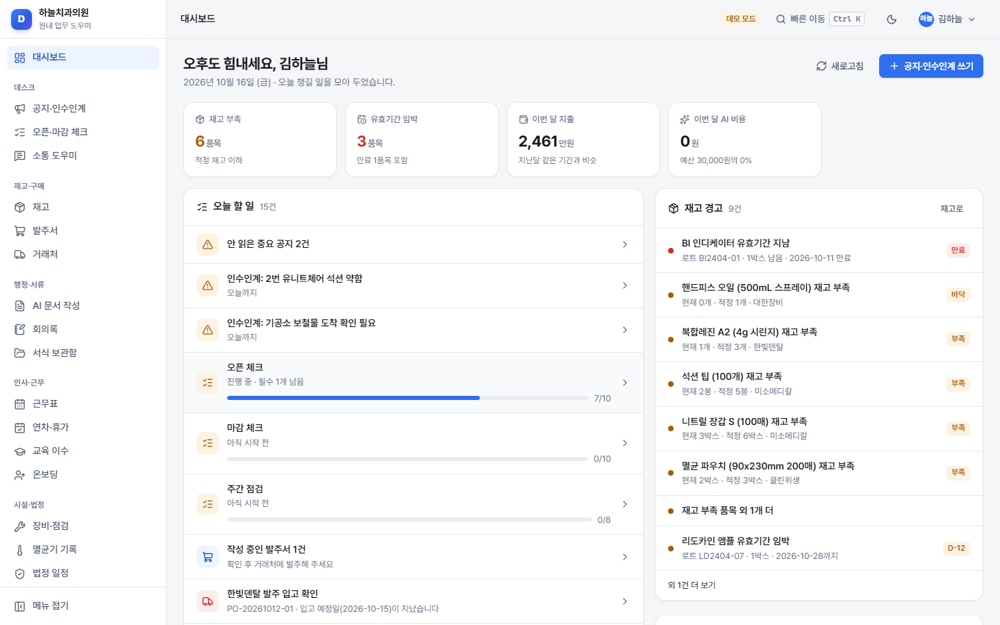
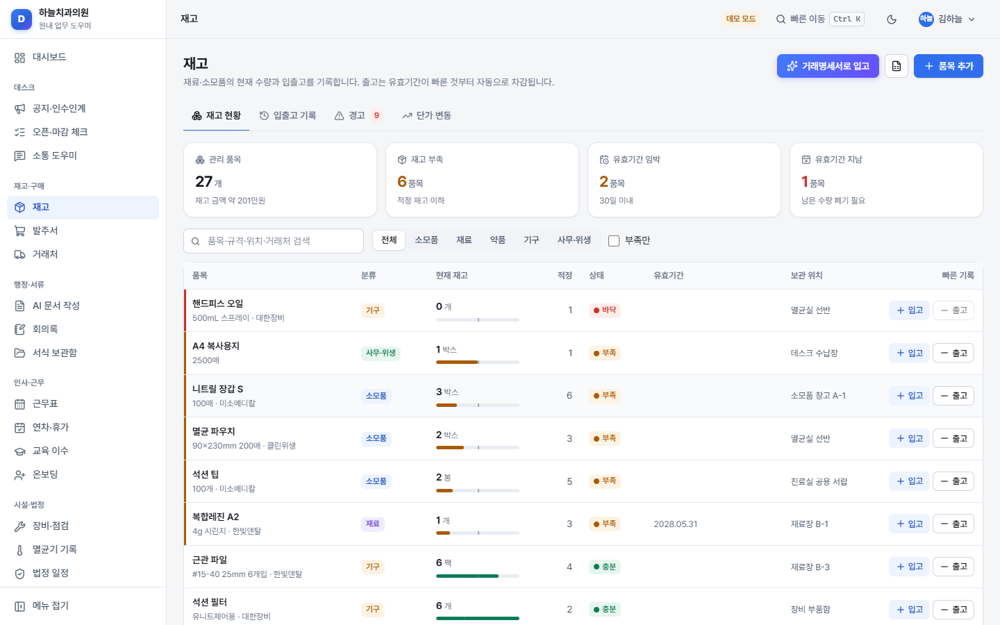
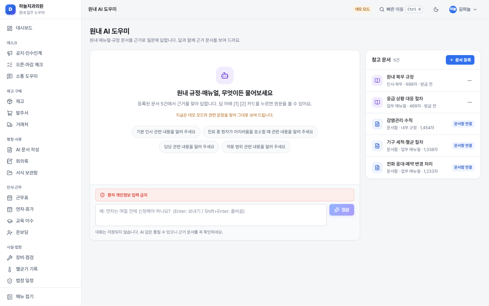
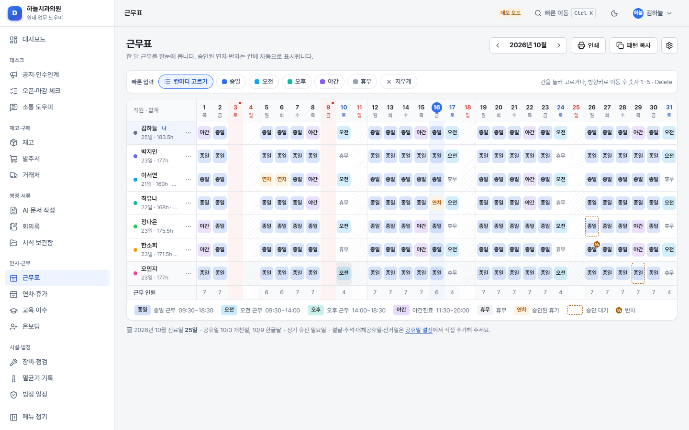
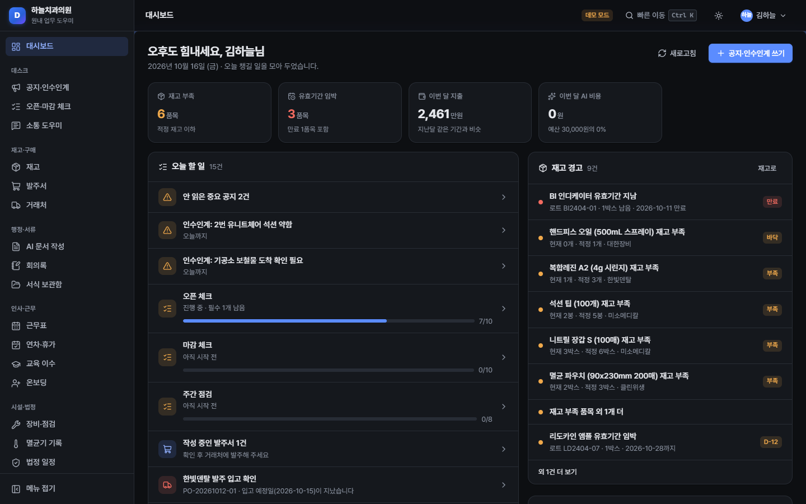

# DentalAX — 치과 원내 업무 AI 도우미

원내 PC 한 대를 서버로 쓰는 **치과 운영 업무용 웹 서비스**입니다.
공지·체크리스트·재고·발주·서류·근무표·연차·장비 점검·멸균 기록·법정 일정·지출을 한곳에서 관리하고,
반복되는 글쓰기(공지, 안내 문자, 리뷰 답글, 공문, 회의록)는 AI가 초안을 써 줍니다.

- **환자 정보를 저장하지 않습니다.** 환자 이름·연락처·주민번호·차트번호·진료 내용을 넣는 칸이 없습니다.
- AI로 보내는 글은 서버가 먼저 검사해 **주민번호·전화번호 등을 가리거나 막습니다.**
- **인터넷에 공개하지 않고** 원내 와이파이(공유기)에 연결된 PC·태블릿·휴대폰에서만 접속합니다.
- **AI 키가 없어도** 모든 기능을 "데모 모드"로 써 볼 수 있습니다.

> 이 서비스는 업무 보조 도구이며 법률 자문을 대신하지 않습니다. 개인정보보호법·의료법(의료광고 등)·노무 관련 판단은 전문가와 상의하세요.

---

## 목차
1. [이 서비스로 할 수 있는 일](#1-이-서비스로-할-수-있는-일)
2. [설치하기 (처음 한 번, 약 20~30분)](#2-설치하기-처음-한-번-약-2030분)
3. [매일 켜고 끄기](#3-매일-켜고-끄기)
4. [직원 PC·태블릿에서 접속하기](#4-직원-pc태블릿에서-접속하기)
5. [첫 설정: 관리자 계정, 직원 추가, AI 키](#5-첫-설정-관리자-계정-직원-추가-ai-키)
6. [백업과 복원](#6-백업과-복원)
7. [업데이트](#7-업데이트)
8. [자주 묻는 질문](#8-자주-묻는-질문)
9. [문제 해결](#9-문제-해결)
10. [외부(인터넷) 공개 시 주의](#10-외부인터넷-공개-시-주의)
11. [폴더 지도 — "이 기능을 고치려면 이 파일"](#11-폴더-지도--이-기능을-고치려면-이-파일)
12. [Claude Code로 수정을 요청하는 요령](#12-claude-code로-수정을-요청하는-요령)
13. [만든 과정 숫자로 보기](#13-만든-과정-숫자로-보기)

---

## 1. 이 서비스로 할 수 있는 일

> 📖 **화면으로 보는 사용 흐름 안내서**: [docs/walkthrough](docs/walkthrough/README.md) — 처음 설정부터 관리까지 캡처 56장과 설명
> 🎬 **시연 영상 (약 3분)**: [docs/walkthrough/dentalax-demo.webm](docs/walkthrough/dentalax-demo.webm)



| 메뉴 | 하는 일 | AI가 돕는 일 |
|---|---|---|
| **대시보드** | 오늘 할 일, 재고 경고, 다가오는 점검·법정 일정, 공지, 오늘 근무자를 한눈에 | — |
| **공지·인수인계** | 공지(고정·중요도), 인수인계, 읽음 확인(누가 안 읽었는지) | 대충 쓴 메모 → 깔끔한 공지 |
| **오픈·마감 체크** | 오픈/마감/주간 체크리스트, 누가 언제 체크했는지 기록 | 체크 항목 제안 |
| **소통 도우미** | 전화 응대 스크립트, 리뷰 답글, 안내 문자·안내문 템플릿(바이트 계산) | 스크립트·답글·문구 초안, 의료광고 주의 표현 검사 |
| **재고 · 발주서 · 거래처** | 품목, 입출고(유효기간 빠른 것부터 차감), 적정재고·유효기간 알림, 단가 변동, 발주서 자동 작성·인쇄, CSV | 거래명세서 글 → 입고 품목 인식, 발주 메시지 |
| **AI 문서 작성 · 회의록 · 서식 보관함** | 공문·안내문·규정·매뉴얼 작성과 문서함, A4 인쇄, 회의록, 서식 파일 보관 | 문서 초안·다듬기, 회의록 요약과 할 일 추출 |
| **근무표 · 연차·휴가 · 교육 이수 · 온보딩** | 월간 근무표, 연차 신청·승인·잔여, 법정 교육 이수 현황, 신규 직원 체크리스트 | 온보딩 항목 제안 |
| **장비·점검 · 멸균기 기록 · 법정 일정** | 장비 점검·수리 이력, 멸균기 회차별 기록(환자 정보 없음), 방사선·소방·감염관리 등 법정 일정 | — |
| **지출·월별 요약** | 지출 기록·분류, 월별·12개월 추이, 카드 내역 CSV 가져오기 | 지출 분류 추천 |
| **원내 AI 도우미** | 원내 매뉴얼·규정을 등록하면 질문에 근거 문서와 함께 답변 | 근거 기반 답변 |
| **관리** | 사용자·권한, 병원 정보, AI 설정·비용·예산, 백업·복원, 활동 기록, 초기화 | — |

<table><tr>
<td></td>
<td></td>
</tr><tr>
<td></td>
<td></td>
</tr></table>

권한은 3단계입니다.
- **원장·관리자**: 모든 기능 + 사용자·AI 설정·백업·초기화
- **실장**: 모든 업무 + 연차 승인, 지출, 발주, AI 사용량 보기
- **직원**: 공지 읽기·인수인계, 체크리스트, 입출고 기록, 연차 신청, 멸균 기록, AI 도구, 원내 AI 도우미

---

## 2. 설치하기 (처음 한 번, 약 20~30분)

서버로 쓸 PC는 **원내에서 하루 종일 켜 두는 Windows 10/11 PC**(예: 데스크 PC)가 좋습니다.

### 1단계: Node.js 설치 (5분)
DentalAX를 움직이는 프로그램입니다.
1. 브라우저에서 **https://nodejs.org/ko/download** 를 엽니다.
2. **"LTS"** 라고 적힌 버전의 **Windows 설치 프로그램(.msi)** 을 내려받습니다. (24 이상)
3. 내려받은 파일을 더블클릭 → **Next** → 약관 동의 체크 → **Next** 를 계속 누릅니다.
   - "Tools for Native Modules" 체크 화면이 나오면 **체크하지 않고** Next. (필요 없습니다)
4. **Install** → (권한 확인 창에서 **예**) → **Finish**.
5. 확인: 시작 메뉴에서 "명령 프롬프트"를 열고 `node -v` 를 입력해 `v24...` 같은 글자가 나오면 성공. (안 나오면 PC를 다시 시작한 뒤 다시 확인)

### 2단계: DentalAX 폴더 놓기 (1분)
- DentalAX 폴더를 **`C:\DentalAX`** 처럼 찾기 쉬운 곳에 둡니다. (바탕화면도 괜찮습니다)
- 폴더 이름이나 위치를 나중에 바꾸면 바로가기만 다시 만들면 됩니다.

### 3단계: install.bat 실행 (2분, 인터넷 필요)
1. DentalAX 폴더에서 **`install.bat`** 을 더블클릭합니다.
2. "Windows의 PC 보호" 파란 창이 뜨면 **추가 정보 → 실행** 을 누릅니다.
3. "설치가 끝났습니다!" 가 나오면 아무 키나 눌러 닫습니다.

### 4단계: 처음 켜기
1. **`start.bat`** 을 더블클릭합니다. 검은 창이 뜨고 잠시 후 브라우저가 자동으로 열립니다.
2. **"Windows 보안 경고 – 방화벽"** 창이 뜨면 **"개인 네트워크"에 체크된 상태로 [액세스 허용]** 을 누릅니다.
   이걸 해야 직원 PC·태블릿에서 접속할 수 있습니다. (공용 네트워크는 체크하지 않아도 됩니다)
3. 브라우저에 **"처음 설정"** 화면이 나오면 [5장](#5-첫-설정-관리자-계정-직원-추가-ai-키)으로 가세요.

### (선택) 바탕화면 바로가기와 자동 실행
- **바로가기**: `start.bat` 을 마우스 오른쪽 클릭 → **추가 옵션 표시 → 바로 가기 만들기** → 만들어진 바로가기를 바탕화면으로 옮깁니다.
- **PC를 켤 때 자동 실행**: `Win + R` → `shell:startup` 입력 → 열린 폴더에 위 바로가기를 복사해 넣습니다.

---

## 3. 매일 켜고 끄기

- **켜기**: `start.bat` (또는 바로가기) 더블클릭 → 검은 창은 **최소화**해 두세요. 브라우저가 자동으로 열립니다.
- **끄기**: 검은 창을 닫거나 `stop.bat` 더블클릭. (진료 후 PC를 끌 때 함께 꺼집니다)
- 검은 창이 꺼져 있으면 아무도 접속할 수 없습니다. "서버에 연결할 수 없습니다"가 보이면 서버 PC의 검은 창부터 확인하세요.
- 자동 백업은 서버가 켜져 있는 동안 **매일 12시 30분 이후 한 번** 실행됩니다.

---

## 4. 직원 PC·태블릿에서 접속하기

1. 서버 PC의 검은 창에 이렇게 나옵니다.
   ```
   이 PC에서:      http://localhost:3800
   직원 PC·태블릿: http://192.168.0.10:3800
   ```
   또는 DentalAX의 **관리 → 시스템·초기화 → 접속 주소**에서도 볼 수 있습니다.
2. 직원 PC·태블릿·휴대폰이 **서버 PC와 같은 와이파이(공유기)** 에 연결되어 있는지 확인합니다.
3. 브라우저(크롬, 엣지, 사파리) 주소창에 `http://192.168.0.10:3800` 처럼 **"직원 PC·태블릿" 주소**를 그대로 입력합니다.
4. 즐겨찾기(북마크)나 "홈 화면에 추가"를 해 두면 편합니다.

> 서버 PC의 주소(192.168.x.x)는 공유기가 정해 주므로 가끔 바뀔 수 있습니다. 접속이 안 되면 검은 창에서 새 주소를 확인하세요.
> 주소가 자주 바뀌면 공유기 설정에서 서버 PC에 "고정 IP(DHCP 예약)"를 해 두면 좋습니다(공유기 업체 안내 참고).

---

## 5. 첫 설정: 관리자 계정, 직원 추가, AI 키

### 관리자 계정 (처음 한 번)
- "처음 설정" 화면에서 **병원 이름, 원장님 이름, 로그인 아이디, 비밀번호**를 정합니다.
- 비밀번호는 **8자 이상, 영문·숫자·기호 중 2가지 이상**. 잊으면 되찾을 수 없으니 안전한 곳에 적어 두세요.
- "데모 예시 데이터 넣기"를 켜면 가상의 "하늘치과의원" 데이터로 둘러볼 수 있습니다.
- 끄고 시작하면 바로 실제로 쓸 수 있도록 **기본 서식**(법정 일정 기본 항목, 오픈·마감·주간 체크리스트, 전화 응대 스크립트·문자 템플릿, 온보딩 템플릿)만 들어갑니다.
  법정 일정은 날짜가 비어 있으니 **법정 일정 메뉴에서 항목별 "마지막 완료일"을 입력**하면 다음 일정이 자동으로 계산됩니다.
  **실제로 쓰기 전에 관리 → 시스템·초기화 → [업무 데이터 모두 지우기]** 로 지우세요. (계정·설정은 남고, 위의 기본 서식이 다시 들어갑니다)

### 병원 정보
- **관리 → 병원 정보**: 주소, 대표 전화, 진료 시간, 주차, 오시는 길, 보험 일반 안내를 적어 두면 AI 전화 스크립트·안내문·인쇄 머리글에 자동으로 쓰입니다.

### 직원 추가
1. **관리 → 사용자·권한 → [직원 추가]**
2. 이름, 직종, 권한(원장·관리자 / 실장 / 직원), 입사일(연차 계산용)을 입력합니다.
3. 직원이 직접 로그인해서 쓰려면 **"로그인 계정 만들기"** 를 켜고 아이디를 정합니다. 임시 비밀번호가 자동으로 만들어집니다.
4. 저장 후 나오는 **아이디와 임시 비밀번호를 직원에게 직접 전달**하세요. 직원은 첫 로그인 때 자기 비밀번호로 바꿉니다.
5. 퇴사 시: 직원 옆 **… → 비활성화**. 기록은 남고 로그인만 막힙니다.
6. 비밀번호를 잊은 직원: **… → 비밀번호 초기화**.

### AI 키 넣기 (선택 — 없으면 데모 모드)
1. Anthropic·OpenAI·Google 중 한 곳에서 API 키를 발급받습니다 → 방법: [docs/LLM_GUIDE.md](docs/LLM_GUIDE.md)
2. **관리 → AI 설정 → API 키**에 붙여넣고 **저장 → 연결 테스트**
3. 위쪽 **AI 공급자**에서 해당 회사를 고르고 맨 아래 **[AI 설정 저장]**
4. **월 예산**(기본 3만 원)을 확인합니다. 넘으면 AI가 자동으로 멈춥니다.
5. 사용량·비용은 **관리 → AI 사용량**에서 봅니다. 예상 비용은 월 몇천 원 수준입니다 → [docs/COST.md](docs/COST.md)

---

## 6. 백업과 복원

- **자동 백업**: 매일 한 번(기본 12:30 이후), 최근 30개 보관. 위치: `DentalAX\data\backups\`
- **수동 백업**: 관리 → 백업·복원 → **[지금 백업]**
- **다른 곳에 보관(중요)**: PC 고장에 대비해 **일주일에 한 번** [내려받기]로 USB나 다른 PC에 복사하세요. 백업은 `.db` 파일 하나입니다.
- **복원**: 목록에서 원하는 시점의 **[복원]** → 확인 문구 "복원" 입력. 지금 상태는 "복원 전" 백업으로 자동 저장되므로 되돌릴 수 있습니다.
- **새 PC로 옮기기**: 새 PC에 DentalAX 설치 → 처음 설정 → 관리 → 백업·복원 → **[파일로 복원]** 에서 USB의 `.db` 파일 선택. (AI 키는 보안상 옮겨지지 않으니 다시 입력)
- 서버를 끈 상태라면 `data\dentalax.db` 파일을 복사하는 것만으로도 완전한 백업입니다.

---

## 7. 업데이트

1. 먼저 **관리 → 백업·복원 → [지금 백업]** 후 [내려받기]로 USB에 복사합니다.
2. 서버를 끕니다(`stop.bat`).
3. 새 버전 DentalAX 폴더를 받아, **기존 폴더의 `data` 폴더(와 `config.json`이 있다면 그것도)를 새 폴더에 복사**합니다.
   - `data` 폴더 안에 DB, 백업, 암호화 열쇠(`secret.key`)가 모두 들어 있습니다.
4. 새 폴더에서 `install.bat` → `start.bat`. 표 구조는 자동으로 최신으로 맞춰집니다.

---

## 8. 자주 묻는 질문

**Q. 환자 이름을 써도 되나요?** 아니요. 이 서비스는 환자 정보를 다루지 않도록 설계했습니다. AI 입력창에 써도 서버가 감지해 가리거나 막지만, 100% 완벽하지 않으니 쓰지 않는 것이 원칙입니다.

**Q. 인터넷이 끊기면?** AI 기능만 "연결하지 못했습니다"라고 나오고, 나머지 기능은 원내망에서 그대로 동작합니다. 글꼴도 내장되어 있어 화면이 깨지지 않습니다.

**Q. 휴대폰에서도 되나요?** 같은 와이파이에 연결되어 있으면 됩니다. 화면은 PC·태블릿에 맞춰져 있고, 휴대폰에서는 왼쪽 위 ☰ 버튼으로 메뉴를 엽니다.

**Q. 어두운 화면으로 바꿀 수 있나요?** 오른쪽 위 달(☾) 버튼. 기기마다 따로 기억합니다.

**Q. 빠르게 메뉴를 찾고 싶어요.** `Ctrl + K` 를 누르고 "재고", "연차"처럼 입력하세요.

**Q. 자동 로그아웃 시간을 바꾸고 싶어요.** 관리 → 시스템·초기화 → 자동 로그아웃. (기본: 8시간 사용 없으면 로그아웃)

**Q. 법정 일정의 주기가 맞나요?** "확인 필요" 표시가 붙은 항목은 주기를 확신할 수 없는 것입니다. 관할 보건소·관련 기관에 확인 후 고쳐 쓰세요. 모든 항목은 수정할 수 있습니다.

**Q. 연차 계산이 우리 병원과 달라요.** 연차·휴가 화면에서 직원별 부여 일수를 직접 고칠 수 있습니다(실장 이상).

**Q. 서버 PC를 바꾸려면?** [6장의 "새 PC로 옮기기"](#6-백업과-복원)를 보세요.

---

## 9. 문제 해결

| 증상 | 해결 |
|---|---|
| `start.bat` 을 눌렀는데 창이 바로 꺼짐 | 명령 프롬프트를 열어 DentalAX 폴더로 이동(`cd C:\DentalAX`) 후 `start.bat` 입력 → 나오는 안내를 확인 |
| "Node.js가 설치되어 있지 않습니다" | [1단계](#1단계-nodejs-설치-5분)를 따라 설치 후 **PC 재시작** |
| "부품 설치에 실패했습니다" | 인터넷 연결 확인 후 `install.bat` 다시 실행. 회사 방화벽이 있다면 잠시 다른 네트워크(휴대폰 핫스팟)로 시도 |
| "3800번 포트를 이미 다른 프로그램이 쓰고 있습니다" | DentalAX가 이미 켜져 있는지(다른 검은 창) 확인. 아니라면 `config.example.json` 을 복사해 `config.json` 으로 이름을 바꾸고 `"port": 3801` 처럼 바꾼 뒤 다시 실행 |
| 서버 PC에서는 되는데 직원 PC·태블릿에서 안 됨 | ① 같은 와이파이인지 ② 주소의 숫자(192.168…)와 `:3800` 을 정확히 입력했는지 ③ 방화벽: 제어판 → Windows Defender 방화벽 → "앱 허용" → **Node.js** 의 "개인" 체크 |
| "원내 네트워크에서만 접속할 수 있습니다" | 외부(LTE·다른 건물)에서 접속한 것입니다. 원내 와이파이에 연결하세요 |
| "허용되지 않은 접속 주소입니다" | 주소창에 IP 주소(192.168…) 또는 PC 이름으로 접속하세요 |
| 로그인이 잠겼어요 | 비밀번호 5번 틀리면 15분 잠깁니다. 원장님이 관리 → 사용자·권한 → … → 잠금 해제 |
| 관리자 비밀번호를 잊었어요 | 서버 PC에서 `reset-password.bat` 더블클릭 → 아이디 입력 → 화면에 나온 임시 비밀번호로 로그인 (서버 PC 앞에서만 가능) |
| AI가 "API 키가 올바르지 않습니다" | 관리 → AI 설정 → 키를 다시 붙여넣고 연결 테스트 |
| AI가 "사용 한도나 충전 잔액이 부족합니다" | AI 회사 사이트에서 크레딧 충전 |
| AI가 "이번 달 AI 예산을 모두 사용" | 관리 → AI 설정 → 월 예산 늘리기 (또는 다음 달 1일까지 대기) |
| 화면이 이상하게 보임 | `Ctrl + F5` (강력 새로고침) |
| 다른 PC로 복원 후 AI 키가 "읽을 수 없음" | 정상입니다(보안상 키는 옮겨지지 않음). 키를 다시 입력하세요 |

서버 창에 나온 빨간 `[오류]` 문구를 사진으로 찍어 두면 문제를 찾는 데 도움이 됩니다.

---

## 10. 외부(인터넷) 공개 시 주의

기본 설정은 **원내 네트워크(사설 IP)에서만 접속**됩니다. 원외에서 쓰고 싶어도 아래 위험을 이해하기 전에는 공개하지 마세요.

- 원내 통신은 암호화되지 않은 **HTTP**입니다. 인터넷에 그대로 열면 비밀번호와 내용이 중간에서 엿보일 수 있습니다.
- 공유기 "포트 포워딩"으로 3800번을 열면 전 세계에서 로그인 화면을 두드릴 수 있습니다.
- 꼭 필요하다면: 보안 전문가와 함께 **VPN**(원외에서 원내망으로 안전하게 들어오는 방법)을 쓰는 것을 권합니다. 직접 공개는 권하지 않습니다.
- `config.json` 의 `allowExternal` 을 `true` 로 바꾸면 외부 IP 차단이 꺼집니다. **HTTPS(인증서)·VPN 없이 켜지 마세요.**
- 자세한 보안 점검 내용: [docs/SECURITY.md](docs/SECURITY.md)

---

## 11. 폴더 지도 — "이 기능을 고치려면 이 파일"

```
DentalAX/
├─ start.bat / stop.bat / install.bat   켜기 / 끄기 / 처음 설치
├─ reset-password.bat                   비밀번호를 잊었을 때 (서버 PC에서 실행)
├─ config.example.json                  포트 등 설정 예시 (config.json 으로 복사해서 사용)
├─ data/                                ★ 데이터 (DB, 백업, 암호화 열쇠) — 지우면 안 됨
├─ server/                              서버(뒤쪽) 코드
│  ├─ index.js                          서버 시작, 접속 주소 안내
│  ├─ app.js                            요청 처리 순서(보안 → 로그인 → 기능)
│  ├─ seed.js                           데모 데이터 넣기 / 초기화
│  ├─ core/                             공통: DB(db.js), 로그인(auth.js), 보안(security.js), 백업(backup.js), 입력 검사(validate.js) …
│  ├─ ai/                               AI: 공급자 연결(providers.js), 개인정보 필터(pii.js), 비용·예산(service.js), 기본 가격(defaults.js)
│  └─ modules/                          기능별 서버 코드 (표 구조, API, AI 지시문, 데모 데이터)
│     ├─ board/        공지·인수인계        ├─ checklists/   오픈·마감 체크
│     ├─ comms/        소통 도우미          ├─ inventory/    재고·발주·거래처
│     ├─ documents/    문서·회의록·서식     ├─ hr/           근무표·연차·교육·온보딩
│     ├─ facility/     장비·멸균·법정 일정   ├─ expenses/     지출
│     ├─ assistant/    원내 AI 도우미       ├─ admin/        관리(사용자·AI 설정·백업·활동 기록)
│     └─ dashboard/    대시보드 모으기
├─ public/                              화면(앞쪽) 코드 — 고치고 브라우저 새로고침하면 바로 반영
│  ├─ css/app.css                       색·글꼴·버튼 등 디자인 전체 규칙 (mod-*.css 는 기능별 추가 디자인)
│  ├─ js/routes.js                      왼쪽 메뉴 목록
│  ├─ js/pages/                         화면별 파일 (board.js = 공지 화면, inventory.js = 재고 화면 …)
│  └─ js/ui/                            공통 부품 (버튼, 표, 팝업, AI 결과 상자 …)
├─ tests/                               자동 테스트 (npm test), tests/e2e 브라우저 테스트
└─ docs/                                문서: PLAN(설계), DECISIONS(결정 이유), CONVENTIONS(개발 규칙), SECURITY, COST, LLM_GUIDE
```

예시
- 재고 화면 글자를 바꾸고 싶다 → `public/js/pages/inventory.js`
- AI 공지 다듬기 말투를 바꾸고 싶다 → `server/modules/board/index.js` 의 `aiFeatures`
- 법정 일정 기본 항목을 바꾸고 싶다 → `server/modules/facility/` (또는 화면에서 직접 수정)
- 개인정보 감지 규칙을 더하고 싶다 → `server/ai/pii.js`
- 색상을 바꾸고 싶다 → `public/css/app.css` 맨 위의 `--accent` 등

---

## 12. Claude Code로 수정을 요청하는 요령

1. DentalAX 폴더에서 Claude Code를 열고, 먼저 **"docs/CONVENTIONS.md 와 PROGRESS.md 를 읽고 시작해 줘"** 라고 말합니다.
2. **무엇을, 어디서, 어떻게** 를 구체적으로:
   - 좋은 예: "재고 화면(#/inventory)의 품목 표에 '보관 위치' 열을 추가해 줘. 실장 이상만 수정 가능하게."
   - 아쉬운 예: "재고 좀 좋게 해 줘."
3. **화면 캡처**를 함께 주면 정확해집니다.
4. 끝나면 **"npm test 로 전체 테스트를 돌리고, 바뀐 화면을 직접 확인해 줘"** 라고 요청합니다.
5. 큰 변경 전에는 **관리 → 백업·복원 → [지금 백업]** 을 먼저 해 두세요.
6. 원칙을 함께 알려 주세요: "환자 정보는 저장하지 않는다", "쉬운 한국어 주석", "기존 디자인 부품(public/js/ui) 사용".

---

## 13. 만든 과정 숫자로 보기

Claude Code(Opus 5.5)에게 **프롬프트 한 번**으로 요청해, 사람의 코드 작성 없이 계획부터 검증까지 진행한 결과입니다. (2026-10-16 측정)

| 항목 | 숫자 |
|---|---|
| 총 걸린 시간 | **약 1시간 45분** (12:35경 시작 → 14:20 완료, 파일 기록 시각 기준) |
| 작업 방식 | 기반·공통 부품을 먼저 만든 뒤, 하위 에이전트 **5개가 모듈을 동시에 개발** (+ 가격 조사 에이전트 1개) |
| 코드 줄 수 (합계) | **약 38,400줄** |
| └ 서버 (`server/`, 69개 파일) | 약 15,000줄 |
| └ 화면 자바스크립트 (`public/js/`, 40개 파일) | 약 13,300줄 |
| └ 디자인 CSS (`public/css/`, 7개 파일) | 약 6,400줄 |
| └ 테스트 (`tests/`, 21개 파일) | 약 4,000줄 |
| └ 실행 스크립트 (`.bat`, `scripts/`) | 약 170줄 |
| 문서 (README·docs·PROGRESS) | 약 1,050줄 |
| 화면 수 | 22개 (+ 상세·인쇄 화면) |
| DB 표 | 43개 (환자 정보 칸 0개) |
| 서버 API | 약 200개 |
| AI 기능 | 13종 (Claude·OpenAI·Gemini·데모 모드) |
| 자동 테스트 | 175개 통과 + 브라우저 E2E 28단계 통과 |
| 점검한 스크린샷 | 34장 (라이트·다크·태블릿) + 사용 흐름 안내서 캡처 56장 + 시연 영상 약 3분(29MB) |
| 실행에 필요한 외부 부품 | 1개 (express) · 알려진 취약점 0건 |

> 줄 수에는 빈 줄·주석(쉬운 한국어 설명)이 포함되며, 외부 라이브러리(`public/vendor`)와 자동 생성한 아이콘 데이터는 뺐습니다.

---

## 개발자용 메모
- 실행: `npm start` · 테스트: `npm test` · 브라우저 E2E: `npm run test:e2e` · 스크린샷: `npm run screenshots` · 사용 흐름 안내서: `npm run walkthrough` · 시연 영상: `npm run walkthrough:video` · 취약점 점검: `npm run audit`
- 영상 녹화에는 Playwright용 ffmpeg가 필요합니다(프로젝트 안에 설치): `PLAYWRIGHT_BROWSERS_PATH=0 node node_modules/playwright-core/cli.js install ffmpeg`
- 기술: Node.js 24 + Express 5 + 내장 SQLite(`node:sqlite`), 화면은 빌드 없는 Preact + htm. 결정 이유: [docs/DECISIONS.md](docs/DECISIONS.md)
- 라이선스 고지: Pretendard(OFL, `public/fonts`), Preact(MIT)·htm(Apache-2.0)(`public/vendor`), Lucide 아이콘(ISC, `public/js/ui`)
