# DentalAX 사용 흐름 안내서 (화면으로 보기)

> 처음 설정부터 매일 쓰는 업무, 관리 기능까지 **실제 화면 캡처와 설명**으로 따라가는 안내서입니다.
> 화면은 자동화 도구(Playwright)로 서비스를 실제로 실행하며 찍었습니다. 병원·직원·업체는 모두 **가상(데모 데이터)** 이며 환자 정보는 없습니다.
> AI 결과는 API 키 없이 동작하는 **데모 모드** 예시입니다. 키를 넣으면 실제 AI가 같은 자리에 답합니다.

## 시연 영상

[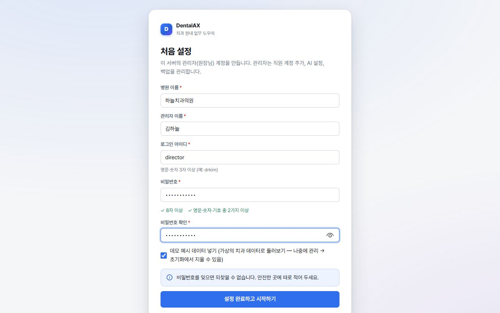](dentalax-demo.webm)

▶ **[시연 영상 보기 (dentalax-demo.webm)](dentalax-demo.webm)** — 처음 설정 → 공지·AI 다듬기 → 체크리스트 → 리뷰 답글 → 재고·명세서 입고 → 발주서 → AI 문서 → 근무표·연차 → 멸균·법정 일정 → 지출 → AI 도우미 → 관리.

> GitHub README 안에서 바로 재생되게 하려면: GitHub 웹에서 README를 편집할 때 이 영상 파일을 편집 칸에 끌어다 놓으면 재생 가능한 주소가 자동으로 들어갑니다.

## 목차

- [1. 처음 설정](#1-처음-설정)
- [2. 대시보드 — 첫 화면](#2-대시보드--첫-화면)
- [3. 공지·인수인계](#3-공지인수인계)
- [4. 오픈·마감 체크리스트](#4-오픈마감-체크리스트)
- [5. 소통 도우미 — 전화 응대·리뷰 답글·안내 문자](#5-소통-도우미--전화-응대리뷰-답글안내-문자)
- [6. 재고 — 입고·출고·유효기간](#6-재고--입고출고유효기간)
- [7. 거래명세서로 한 번에 입고 (AI)](#7-거래명세서로-한-번에-입고-ai)
- [8. 발주서와 거래처](#8-발주서와-거래처)
- [9. AI 문서 작성 — 공문·안내문·규정·매뉴얼](#9-ai-문서-작성--공문안내문규정매뉴얼)
- [10. 회의록 요약과 서식 보관함](#10-회의록-요약과-서식-보관함)
- [11. 근무표·연차·교육·온보딩](#11-근무표연차교육온보딩)
- [12. 장비 점검·멸균기 기록·법정 일정](#12-장비-점검멸균기-기록법정-일정)
- [13. 지출·월별 요약](#13-지출월별-요약)
- [14. 원내 AI 도우미](#14-원내-ai-도우미)
- [15. 관리 — 사용자, AI 설정, 비용, 백업](#15-관리--사용자-ai-설정-비용-백업)
- [16. 편의 기능 — 빠른 이동, 다크 모드, 태블릿·휴대폰](#16-편의-기능--빠른-이동-다크-모드-태블릿휴대폰)
- [17. 직원 계정으로 쓰기](#17-직원-계정으로-쓰기)

---

## 1. 처음 설정

서버를 처음 켜면(start.bat) 브라우저에 **처음 설정** 화면이 나옵니다. 병원 이름과 원장님(관리자) 계정을 만듭니다. 코드에 들어 있는 기본 비밀번호는 없습니다.

*병원 이름·관리자 이름·아이디·비밀번호를 입력합니다. 비밀번호는 8자 이상, 영문·숫자·기호 중 2가지 이상. "데모 예시 데이터 넣기"를 켜면 가상의 치과 데이터로 둘러볼 수 있습니다(나중에 관리 화면에서 지움).*

---

## 2. 대시보드 — 첫 화면

로그인하면 **대시보드**가 첫 화면입니다. 오늘 할 일, 재고 경고, 다가오는 점검·법정 일정, 공지, 오늘 근무자가 한 화면에 모입니다. 각 줄을 누르면 해당 화면으로 바로 이동합니다.

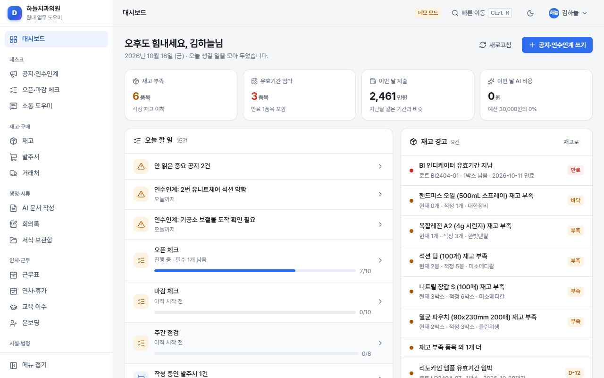

*대시보드 위쪽: 숫자 카드(재고 부족, 유효기간 임박, 이번 달 지출, 이번 달 AI 비용)와 "오늘 할 일"(체크리스트 진행률, 안 읽은 중요 공지, 인수인계, 발주·법정 일정 등), 오른쪽 "재고 경고".*

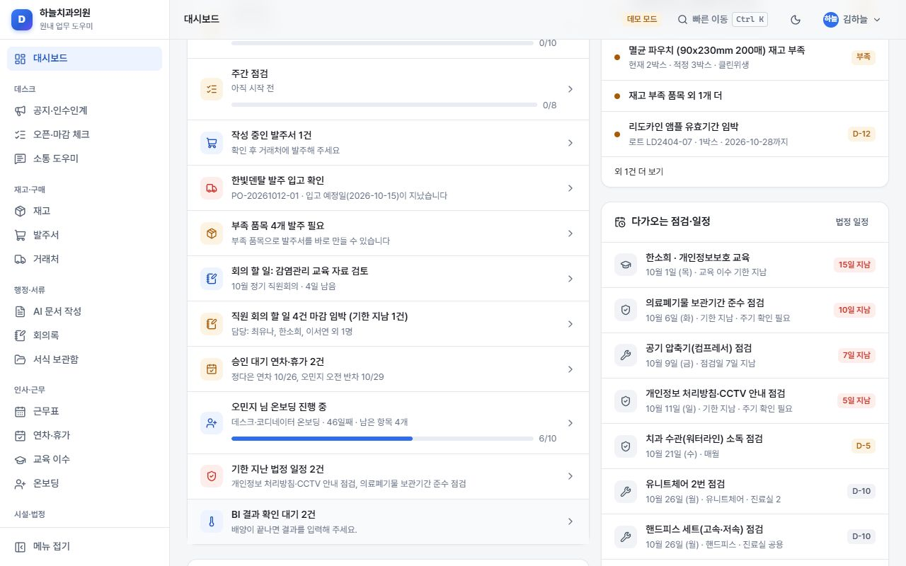

*대시보드 아래쪽: 공지·인수인계, 다가오는 점검·일정(D-day 배지), 오늘 근무자·휴가자.*

---

## 3. 공지·인수인계

원내 공지와 근무자 간 인수인계를 한곳에서 관리합니다. 글을 열면 자동으로 **읽음**이 기록되어 누가 아직 안 읽었는지 바로 보입니다. 메모처럼 대충 적고 **AI로 다듬기**를 누르면 깔끔한 글이 됩니다.

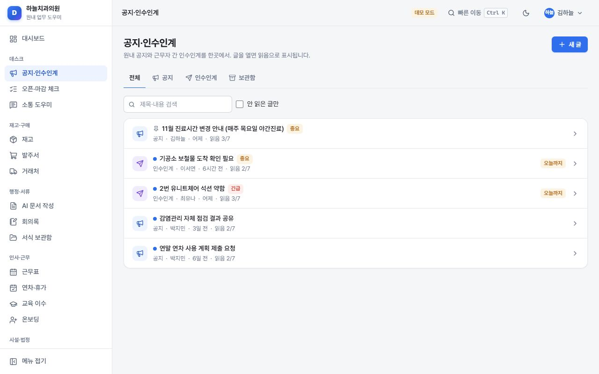

*목록: 고정 공지가 맨 위, 안 읽은 글은 파란 점. 탭으로 공지/인수인계/보관함을 나눠 봅니다.*

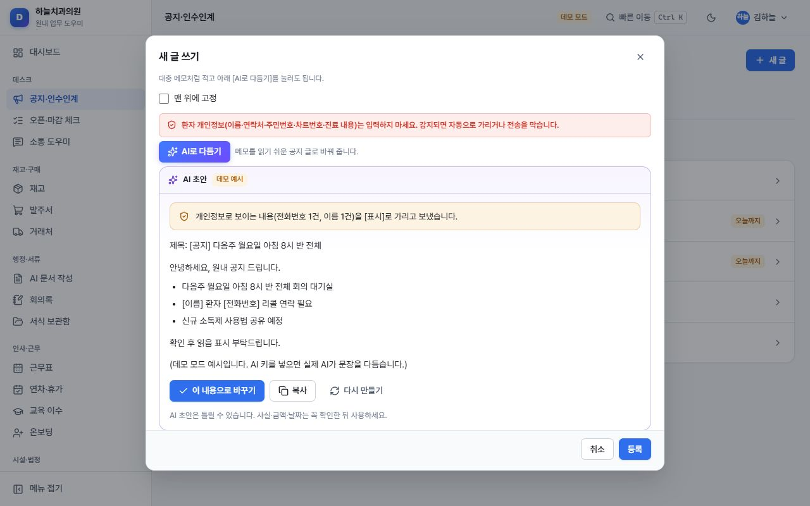

*AI 다듬기 결과. 위쪽 노란 안내처럼 "전화번호 1건, 이름 1건을 가리고 보냈습니다" — 개인정보는 서버가 먼저 찾아서 가린 뒤 AI로 보냅니다(주민번호·카드번호는 아예 차단). 키가 없을 때는 "데모 예시"로 동작합니다.*

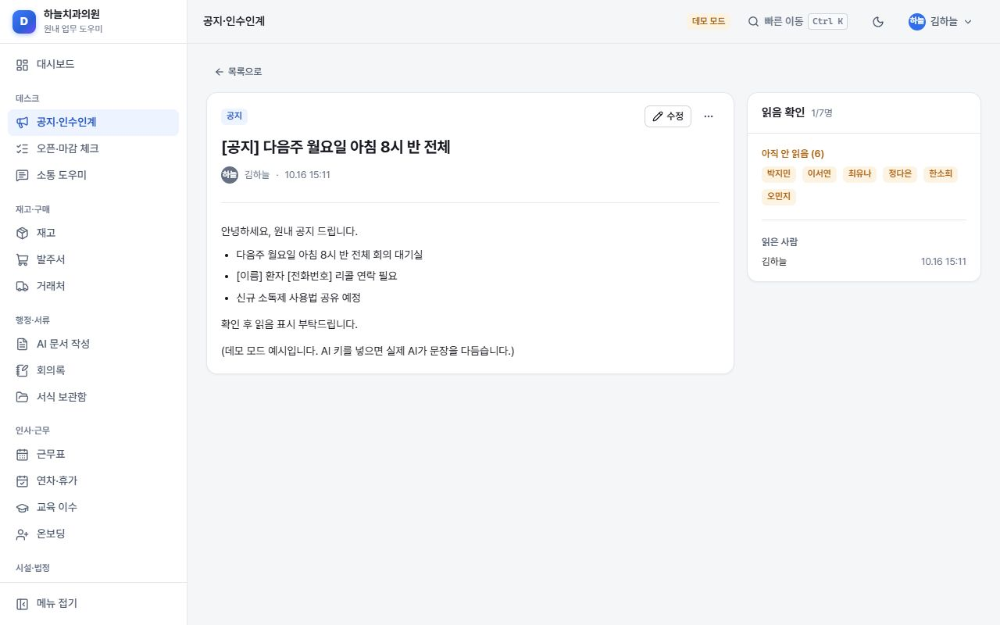

*글 상세: 오른쪽 "읽음 확인"에 아직 안 읽은 직원과 읽은 시각이 표시됩니다.*

---

## 4. 오픈·마감 체크리스트

오픈·마감·주간 점검을 태블릿에서 손가락으로 체크합니다. **누가 몇 시에 체크했는지** 남고, 항목별 짧은 메모도 남길 수 있습니다. 템플릿은 실장 이상이 편집하며, AI로 항목을 제안받을 수 있습니다.

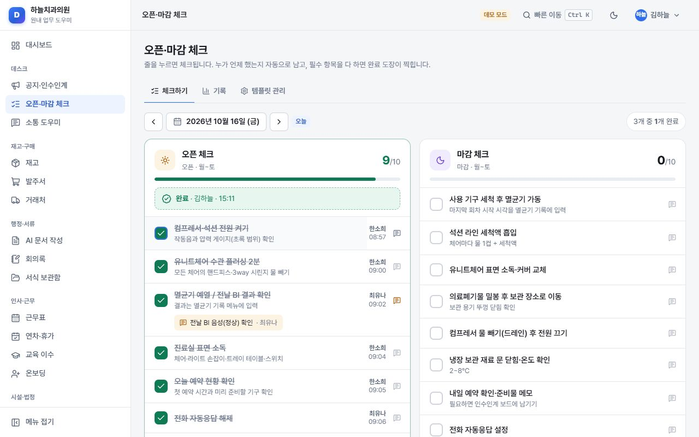

*오늘의 체크리스트. 진행률, 체크한 사람·시각, 메모가 함께 보입니다. 날짜를 바꿔 지난 기록도 볼 수 있습니다.*

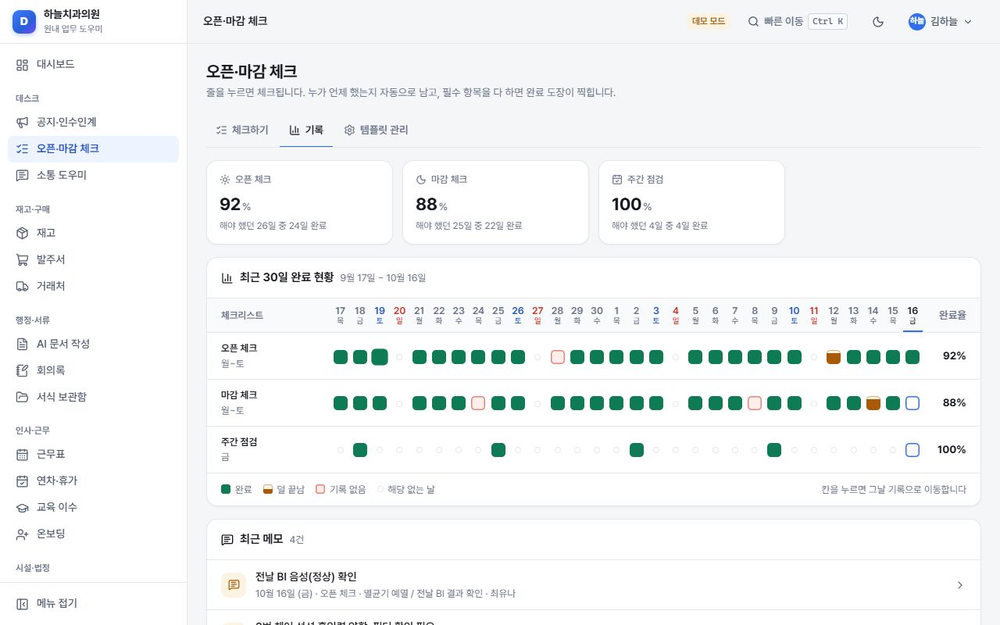

*"기록" 탭: 최근 30일 템플릿별 완료율과 남긴 메모.*

---

## 5. 소통 도우미 — 전화 응대·리뷰 답글·안내 문자

병원 정보(진료시간·주차·보험 일반 안내)를 바탕으로 **전화 응대 스크립트**, **온라인 리뷰 답글**, **안내 문자 문구**를 AI가 초안으로 만들어 줍니다. 리뷰 답글은 의료광고 규정상 위험한 표현(최고·완치·보장 등)을 자동으로 검사합니다. 리뷰 원문은 저장하지 않습니다.

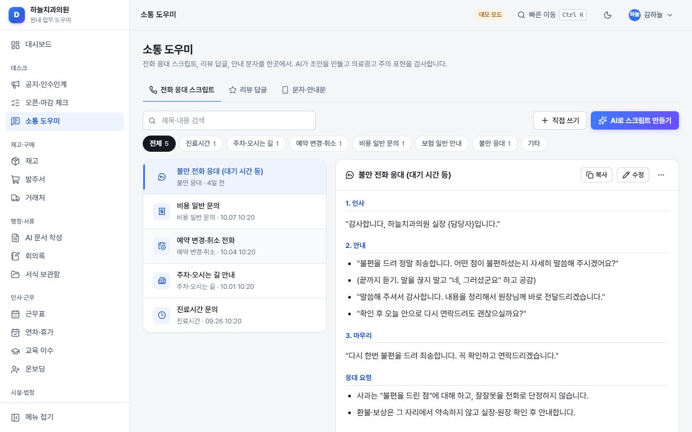

*전화 응대 스크립트 보관함. 상황별(진료시간, 주차, 예약 변경, 비용 일반, 불만 응대…)로 저장하고 바로 복사합니다. [AI로 스크립트 만들기]로 새로 만들 수 있습니다.*

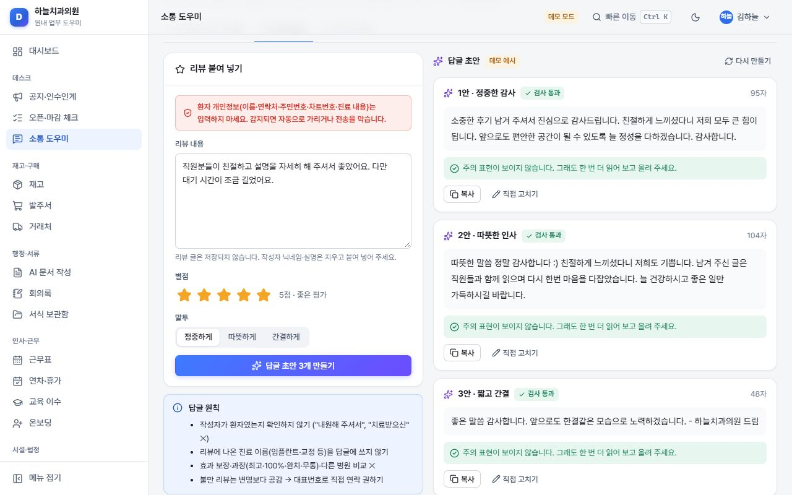

*리뷰 답글 초안 3개. 각 초안마다 "주의 표현 검사" 결과가 붙고, 직접 고치면 바로 다시 검사합니다. 리뷰 원문과 답글은 서버에 저장하지 않습니다.*

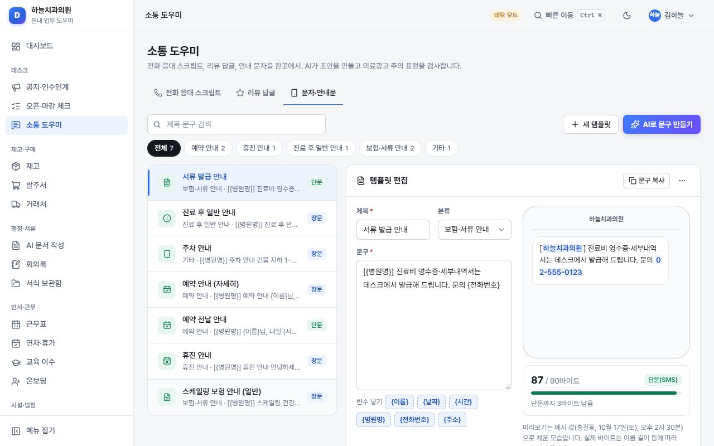

*안내 문자·안내문 템플릿. {이름} {날짜} 같은 빈칸 변수, 미리보기, 단문(90바이트)/장문 바이트 계산을 지원합니다.*

---

## 6. 재고 — 입고·출고·유효기간

재료·소모품의 현재 수량을 관리합니다. 목록에서 바로 **[입고]·[출고]** 를 눌러 기록하고, 출고는 **유효기간이 빠른 로트부터** 자동 차감됩니다. 적정 재고 미만·유효기간 임박/만료는 경고로 모입니다.

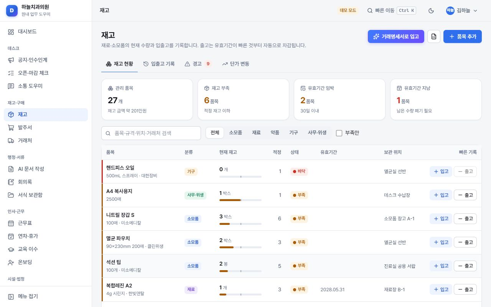

*재고 현황: 위쪽 요약 카드, 분류 필터, "부족만" 보기, 각 줄의 [입고]·[출고] 빠른 기록 버튼.*

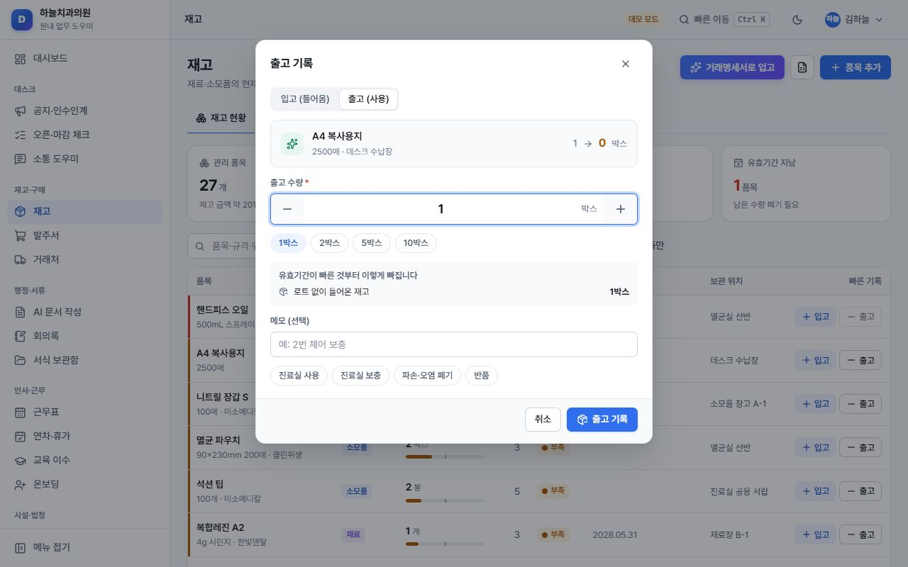

*출고 창: 수량(± 버튼·빠른 선택), 메모 칩. 유효기간 관리 품목은 어느 로트에서 빠질지 미리 보여 줍니다.*

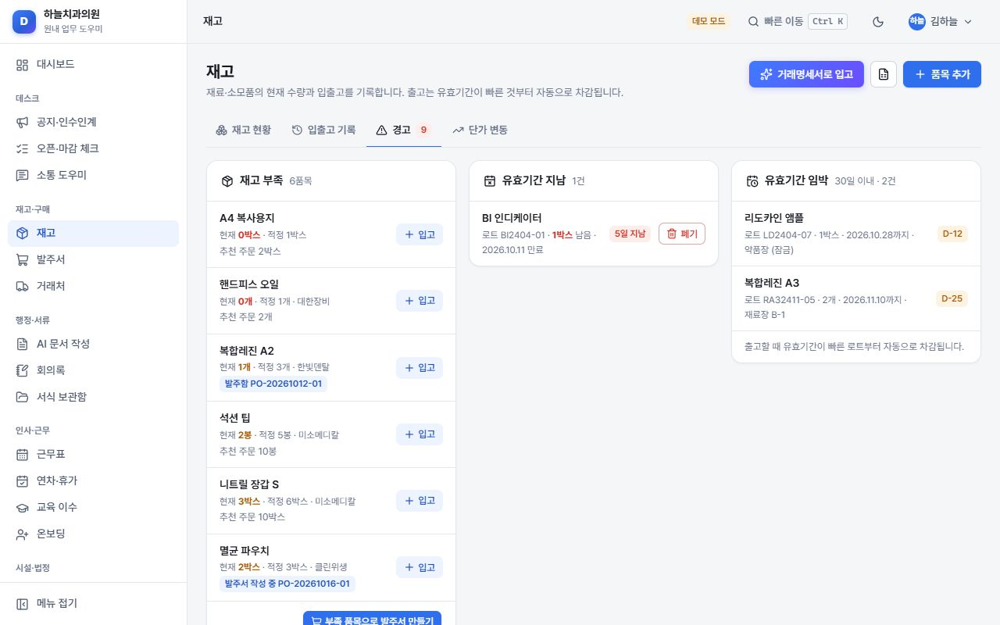

*"경고" 탭: 재고 부족 품목과 유효기간 임박·만료 로트. 만료품은 [폐기]로 따로 처리합니다(자동 출고되지 않음).*

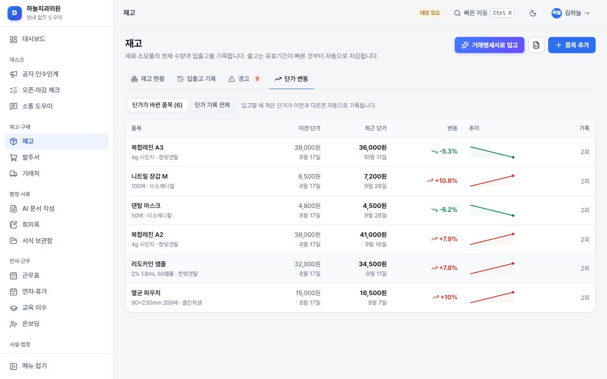

*"단가 변동" 탭: 입고할 때 단가가 바뀌면 자동으로 기록되고 변동률이 표시됩니다.*

---

## 7. 거래명세서로 한 번에 입고 (AI)

택배로 온 **거래명세서 내용을 붙여 넣으면** AI가 품목·수량·단가를 읽어 기존 품목과 짝을 맞추고, 확인 후 한 번에 입고합니다.

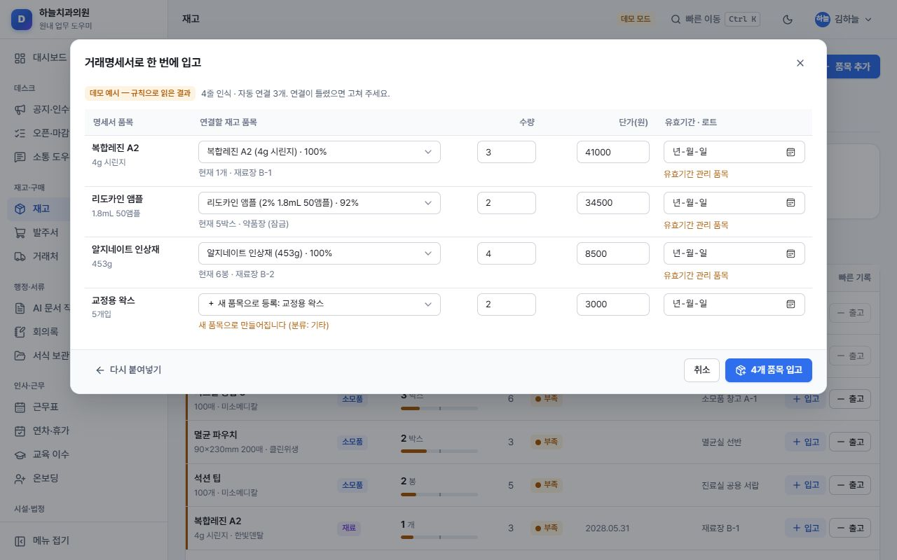

*AI 인식 결과: 명세서의 각 줄을 기존 품목과 짝지어 보여 줍니다. 짝이 틀리면 바꾸거나 새 품목으로 등록한 뒤 한 번에 입고합니다.*

---

## 8. 발주서와 거래처

**부족 품목으로 발주서 만들기**를 누르면 거래처별로 묶은 발주서 초안이 자동으로 생깁니다. A4로 인쇄하거나 PDF로 저장하고, 거래처에 보낼 메시지(카톡·문자·이메일)도 AI가 써 줍니다. 입고 처리하면 재고에 바로 반영됩니다.

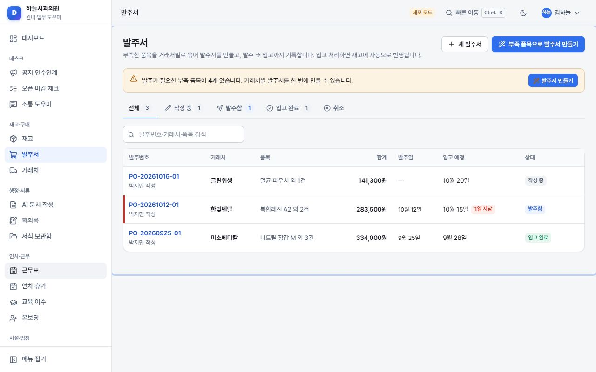

*발주서 목록: 작성 중 → 발주함 → 입고 완료 상태, 입고 예정일이 지나면 빨간 배지.*

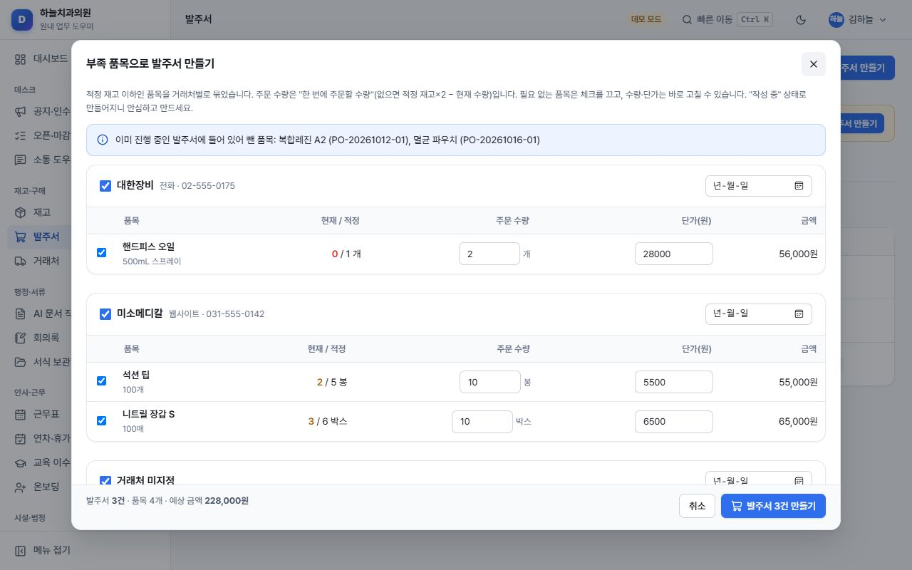

*자동 발주 미리보기: 부족 품목을 거래처별로 묶고, 수량은 "발주 수량" 설정 또는 적정 재고 기준으로 채웁니다.*

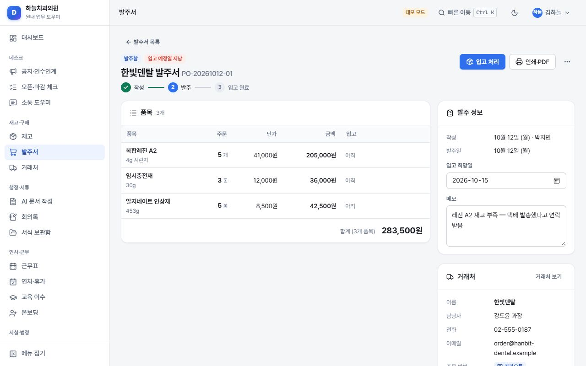

*발주서 상세: 품목·수량·단가 편집, [발주] → [입고 처리](부분 입고 가능), AI 발주 메시지 만들기.*

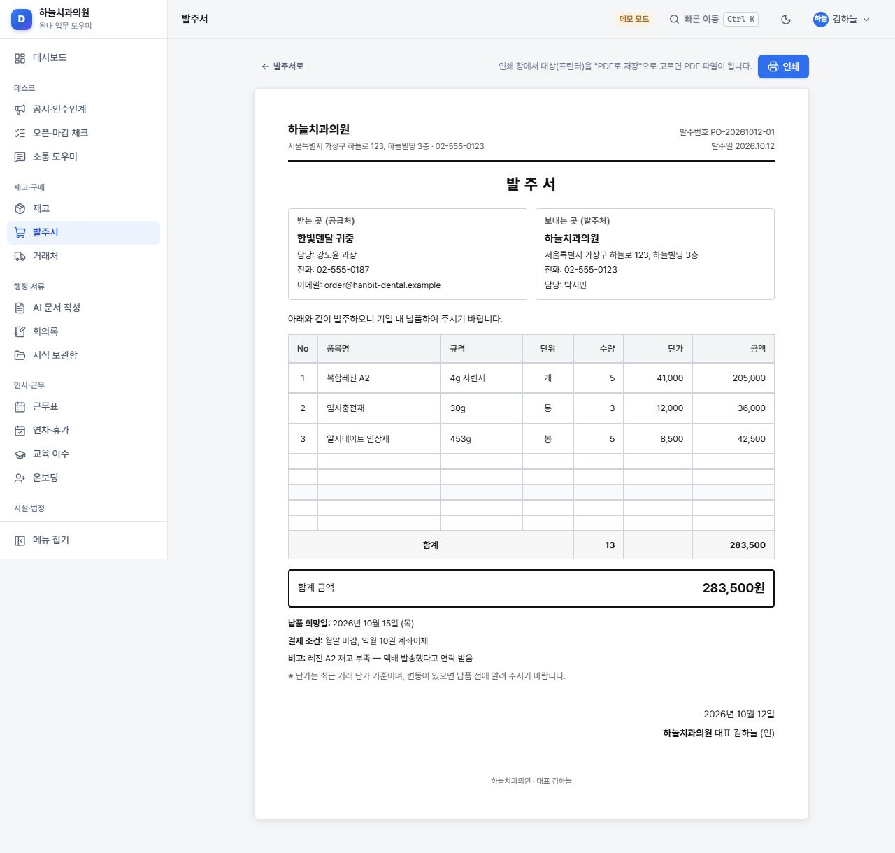

*A4 인쇄 화면: 병원 머리글이 들어간 발주서. 인쇄 창에서 "PDF로 저장"을 고르면 PDF가 됩니다.*

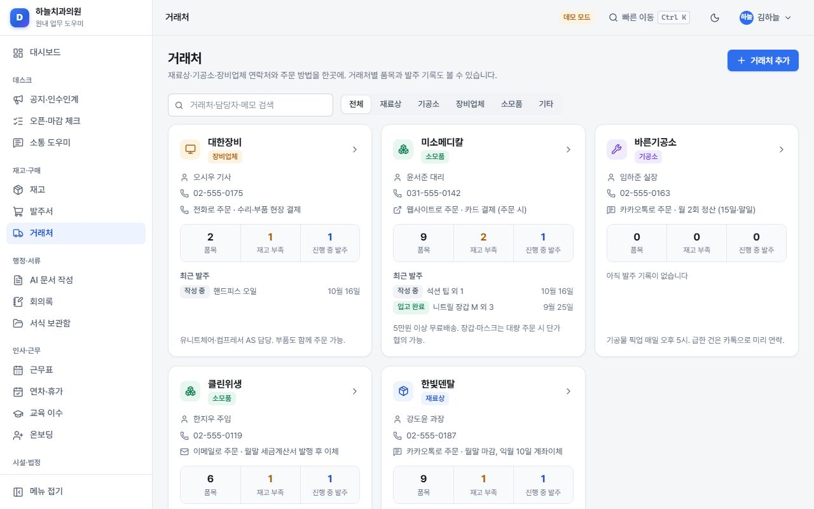

*거래처: 담당자·주문 방법·결제 조건, 거래 품목 수와 최근 발주. (병원의 업무 연락처만 저장)*

---

## 9. AI 문서 작성 — 공문·안내문·규정·매뉴얼

문서 종류를 고르고 **목적과 핵심 메모**만 적으면 AI가 형식에 맞는 초안을 써 줍니다(공문은 수신·제목·본문·붙임·발신 명의 형식). 편집기에서 고치고 "다시 쓰기·더 짧게·더 정중하게·맞춤법" 다듬기를 한 뒤 문서함에 저장하고 A4로 인쇄합니다.

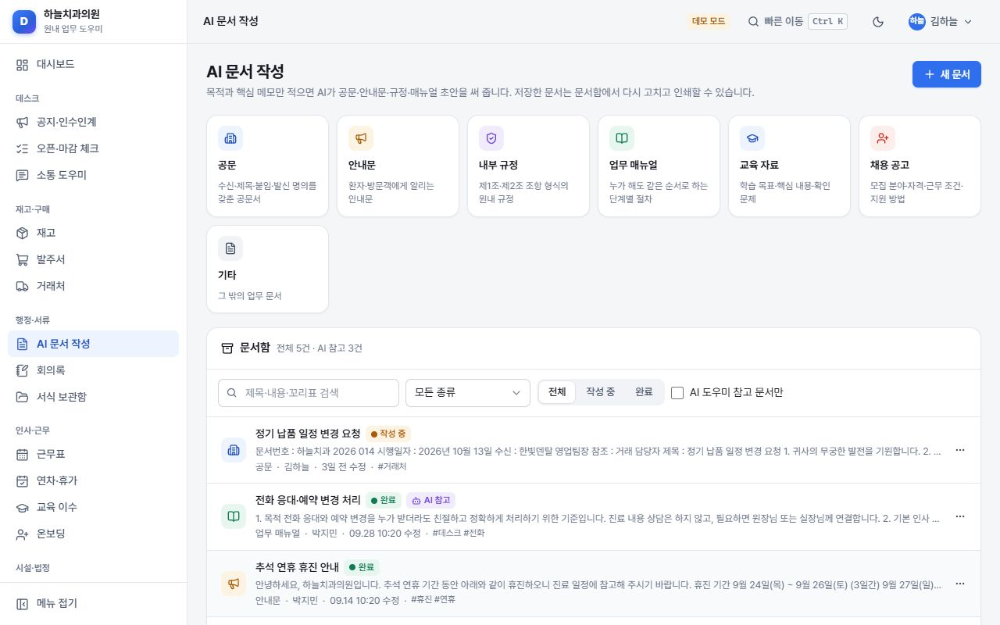

*문서함과 문서 종류 바로가기. "AI 참고" 표시가 있는 문서는 원내 AI 도우미가 답할 때 근거로 씁니다.*

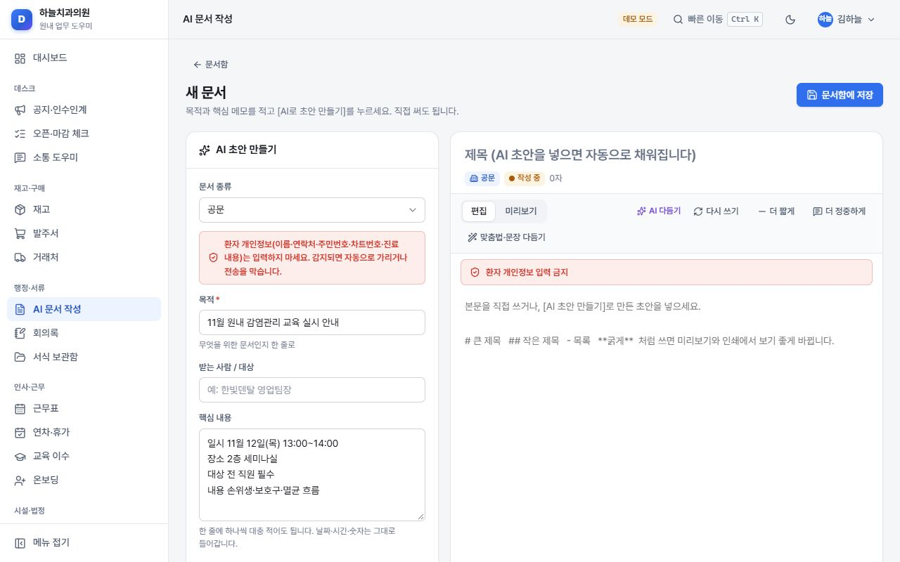

*AI 초안: 공문 형식(문서번호·수신·참조·제목·본문·붙임·발신 명의)에 맞춰 작성됩니다.*

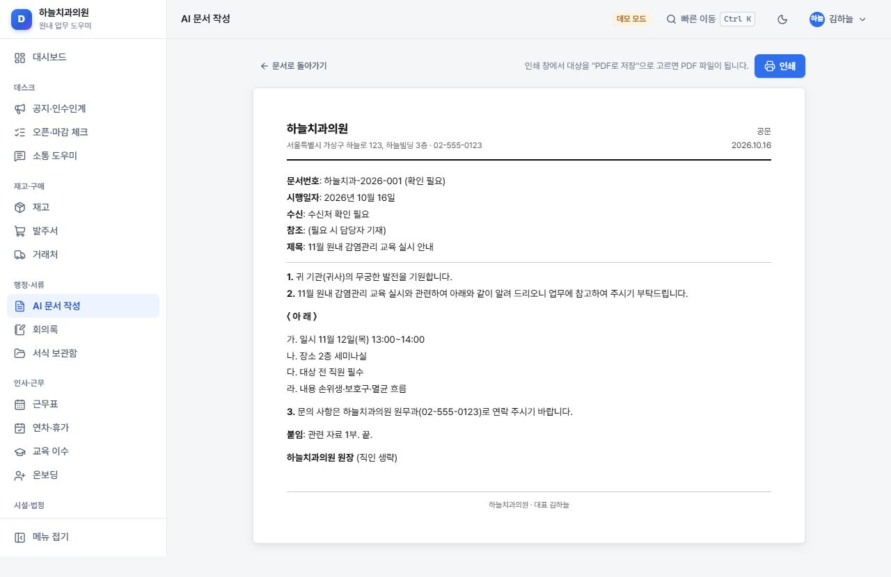

*인쇄 화면: 병원 이름·주소·전화가 머리글로 들어간 A4 공문.*

---

## 10. 회의록 요약과 서식 보관함

회의 메모를 붙여 넣으면 AI가 **요약·결정 사항·할 일(담당자·기한)** 로 정리합니다. 할 일은 체크 표시로 관리하고, 실장 이상은 할 일을 공지로 올릴 수 있습니다. 자주 쓰는 양식 파일은 서식 보관함에 둡니다.

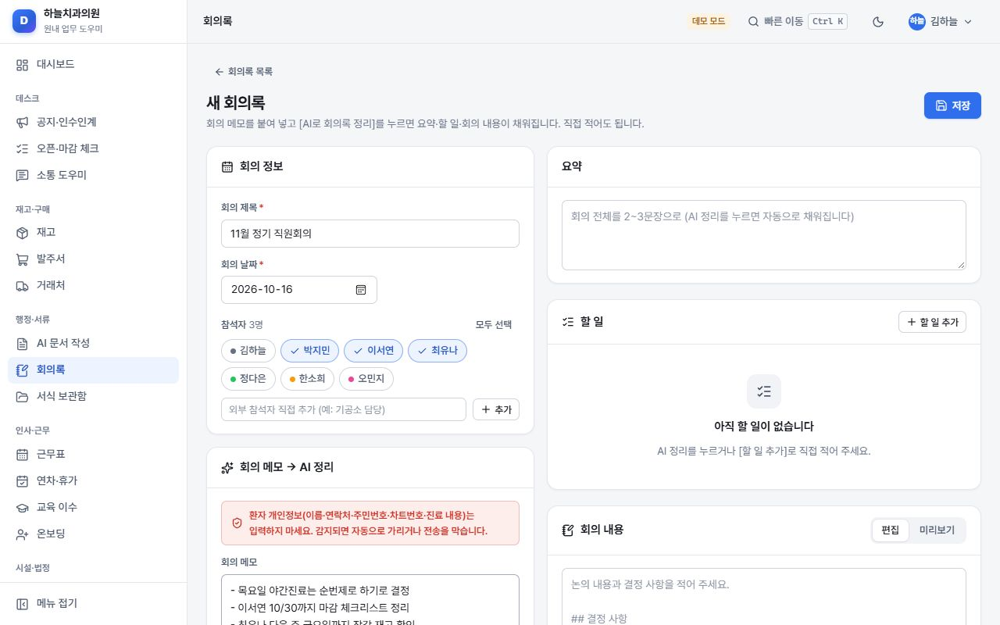

*AI 회의록 정리: 요약, 결정 사항, 할 일(담당자·기한 날짜 자동 인식).*

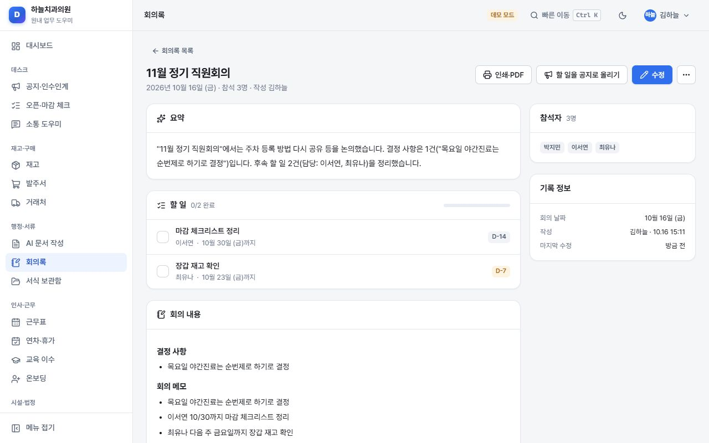

*저장된 회의록: 할 일을 체크하며 관리하고, [할 일을 공지로 올리기]로 보드에 공유합니다.*

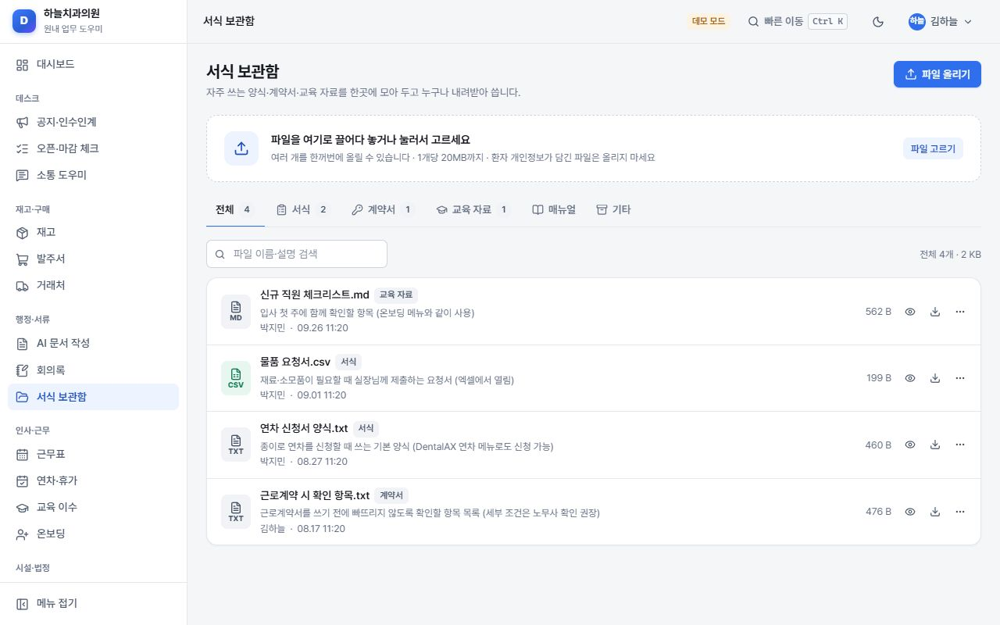

*서식 보관함: 파일을 끌어다 놓아 올리고, 분류·검색·내려받기. 텍스트·이미지는 미리보기.*

---

## 11. 근무표·연차·교육·온보딩

월간 **근무표**는 칸을 눌러 근무 유형을 고르거나 숫자키로 빠르게 입력합니다. 승인된 연차·반차는 근무표에 자동 표시됩니다. **연차**는 입사일 기준 자동 계산(직접 수정 가능), 신청 → 실장 승인 흐름이고, 법정 **교육 이수** 현황과 신규 직원 **온보딩**도 관리합니다.

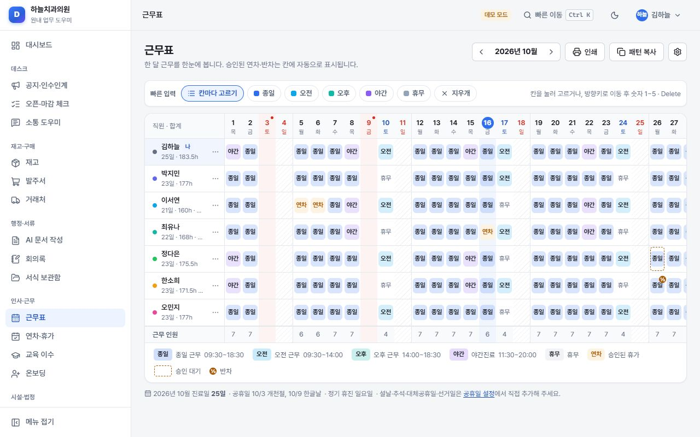

*근무표: 직원별 근무일수·시간 합계, 날짜별 근무 인원, 공휴일·주말 색 구분, 지난 패턴 복사, 인쇄.*

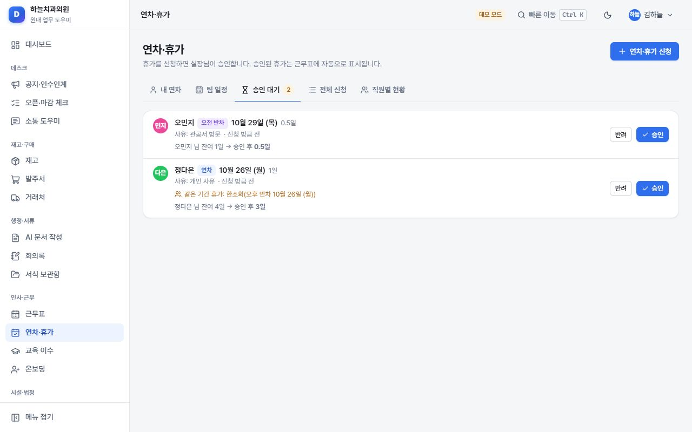

*승인 대기: 같은 기간 휴가자 경고, 승인 후 남는 연차가 함께 보입니다.*

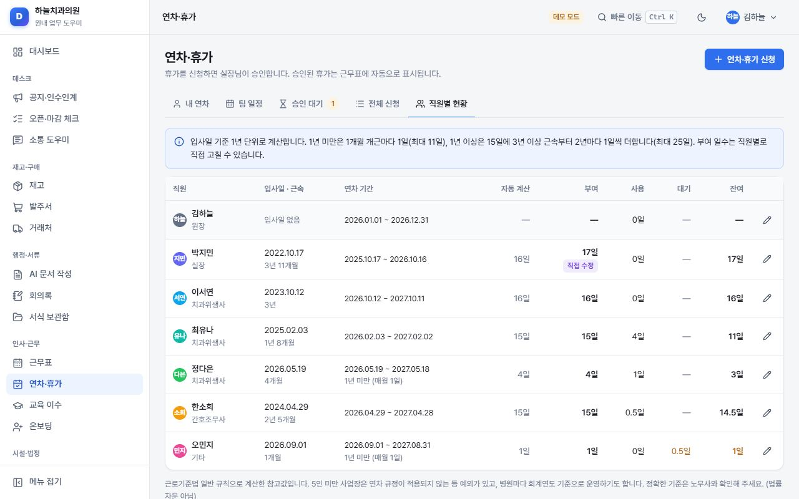

*직원별 연차 현황: 부여(입사일 기준 자동 계산, 직접 수정 가능)·사용·잔여.*

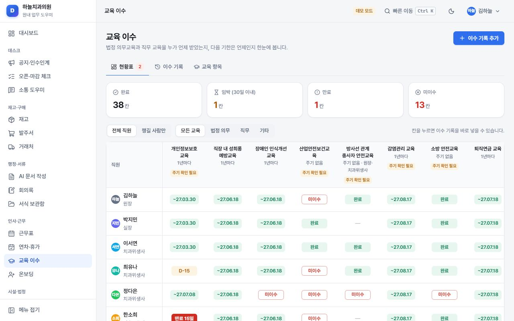

*교육 이수 현황표: 직원 × 교육. 다음 기한, 임박(30일 이내)·만료·미이수 표시. "주기 확인 필요" 표시는 주기를 꼭 확인할 항목입니다.*

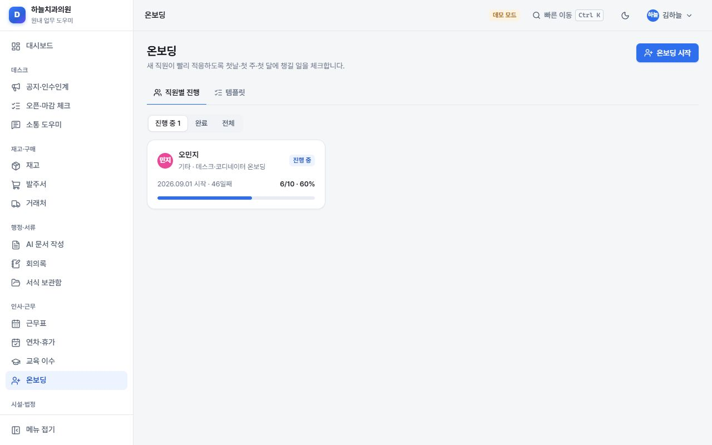

*온보딩: 신규 직원별 진행률과 첫날/첫 주/첫 달 체크 항목. 템플릿은 직종별로 만들고 AI로 항목을 제안받을 수 있습니다.*

---

## 12. 장비 점검·멸균기 기록·법정 일정

장비별 **점검·수리 이력**과 다음 점검일, 멸균기 **회차별 기록**(온도·압력·시간·지시계 결과 — 환자 정보 없음), 방사선·소방·감염관리 등 **법정 정기 일정**을 관리합니다. 법정 주기가 확실하지 않은 항목은 "주기 확인 필요"로 표시되고 직접 고칠 수 있습니다.

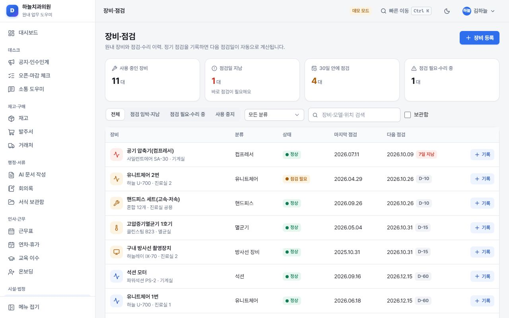

*장비 목록: 상태(정상·점검 필요·수리 중), 다음 점검 D-day, [기록]으로 점검·수리 이력 바로 추가.*

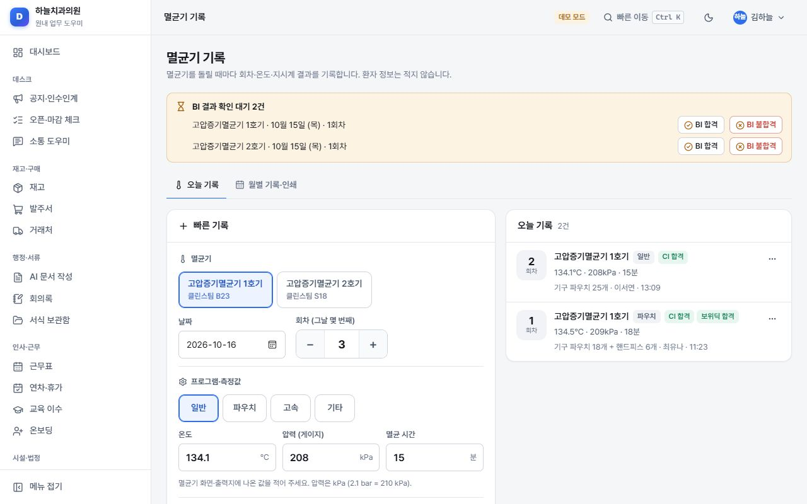

*멸균기 빠른 기록: 멸균기 선택, 회차, 프로그램, 온도·압력·시간, CI/BI/보위딕 결과, 적재물(물건과 개수만). 불합격이면 조치 안내가 뜹니다.*

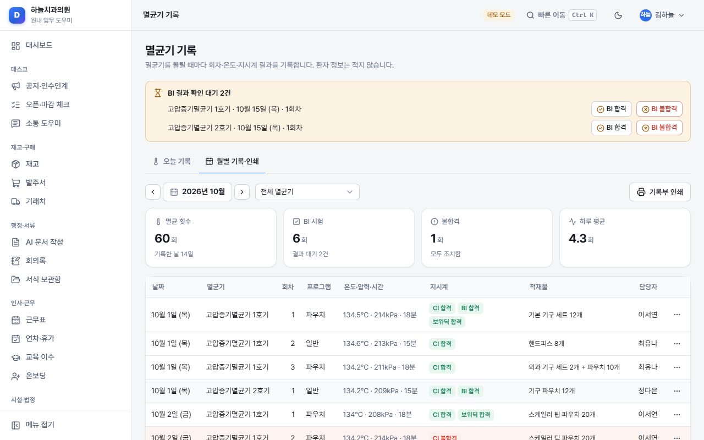

*월별 기록: 한 달 기록부를 표로 보고 A4로 인쇄(서명란 포함)합니다.*

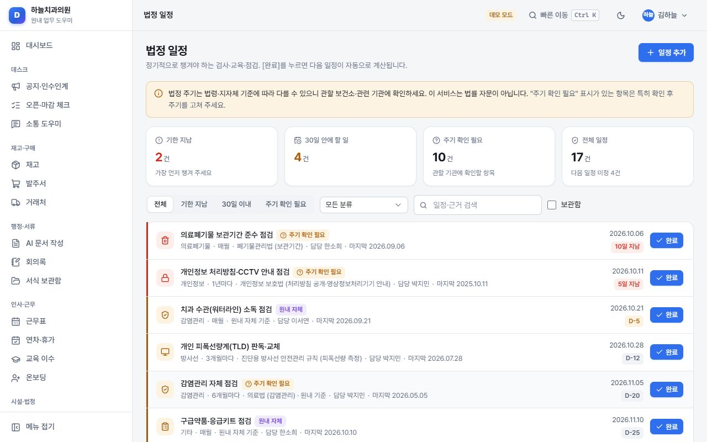

*법정 일정: 기한 지남·30일 이내·주기 확인 필요 요약, 항목별 근거 법령 메모와 담당자, [완료] 처리. "법률 자문이 아님" 안내가 항상 보입니다.*

---

## 13. 지출·월별 요약

병원에서 쓴 돈(지출)만 기록합니다(환자 진료비 같은 매출은 다루지 않음). 분류별 지출, 12개월 추이, 전월 대비, 많이 쓴 곳을 한눈에 보고, 카드사 CSV를 가져와 키워드·AI로 분류를 추천받습니다. 실장 이상만 볼 수 있습니다.

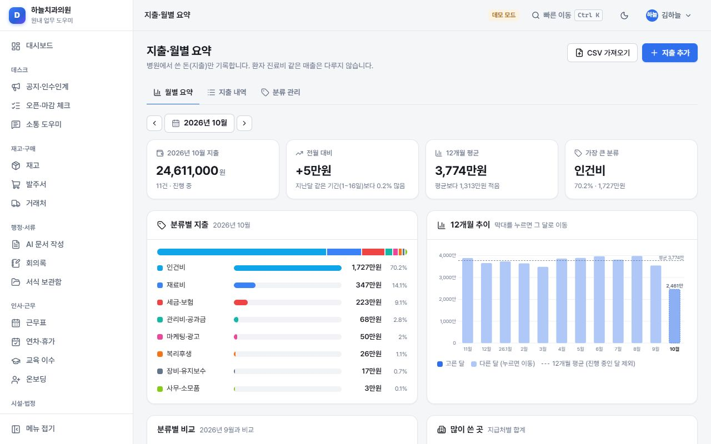

*월별 요약: 이번 달 지출, 전월 같은 기간 대비, 12개월 평균, 분류별 막대, 12개월 추이 그래프.*

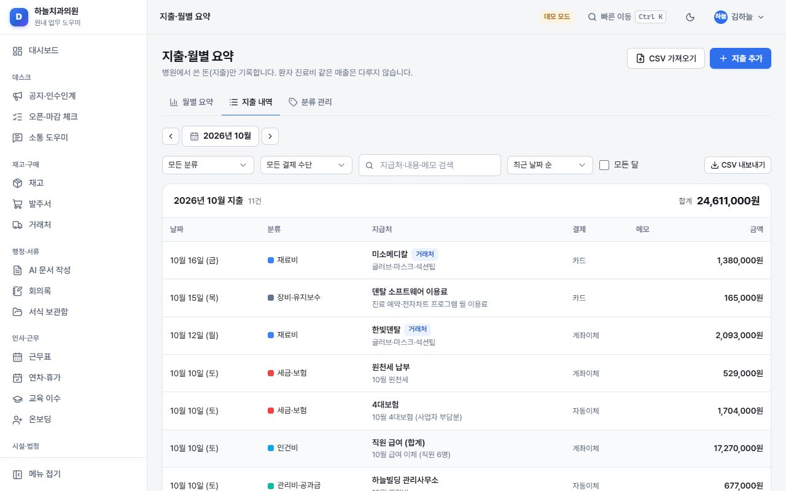

*지출 내역: 월·분류·결제 수단 필터, 검색, CSV 내보내기·가져오기.*

---

## 14. 원내 AI 도우미

원내 매뉴얼·규정 문서를 등록하면(붙여넣기 또는 txt·md·csv·docx 파일) 질문에 **그 문서를 근거로** 답하고, 근거가 된 문단을 [1] [2] 카드로 보여 줍니다. 문서함에서 "AI 도우미가 참고"로 표시한 문서도 자동으로 함께 검색됩니다. 질문 내용은 저장하지 않습니다.

![질문 → 근거 문단을 찾아 답하고, 아래에 근거 문서 카드([1] [2]](images/39-assistant.jpg)

*질문 → 근거 문단을 찾아 답하고, 아래에 근거 문서 카드([1] [2])를 붙입니다. 키가 없는 데모 모드에서도 관련 문장을 찾아 보여 줍니다. 오른쪽은 참고 문서 목록.*

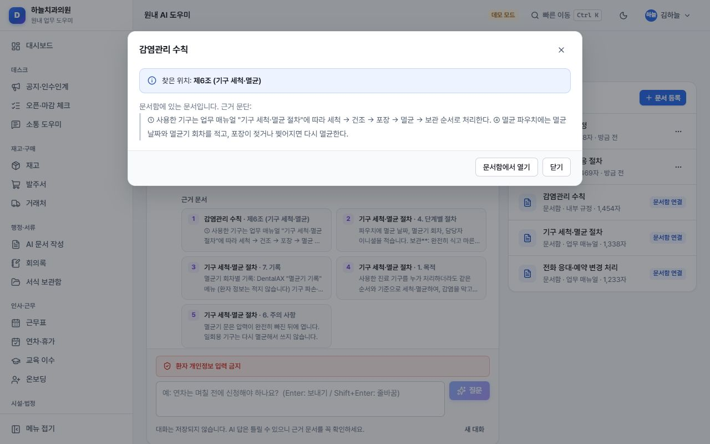

*근거 문서 보기: 어느 문서의 어느 위치에서 찾았는지 확인합니다.*

---

## 15. 관리 — 사용자, AI 설정, 비용, 백업

원장·관리자 전용 화면입니다. **직원 계정**(임시 비밀번호 → 첫 로그인 때 본인이 변경), **AI 설정**(공급자·API 키·기능별 모델 등급·가격표·월 예산), **AI 사용량·비용**, **백업·복원**, **활동 기록**, 접속 주소와 초기화를 관리합니다.

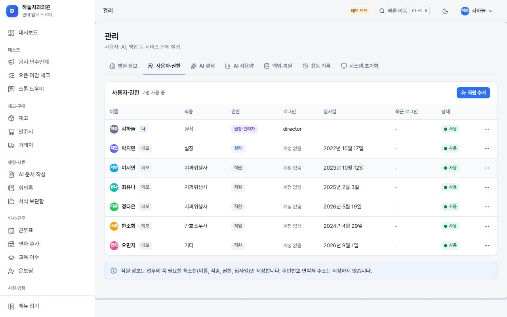

*사용자·권한: 원장·관리자 / 실장 / 직원 3단계 권한. 로그인 계정이 없는 직원도 근무표·연차용으로 등록할 수 있습니다.*

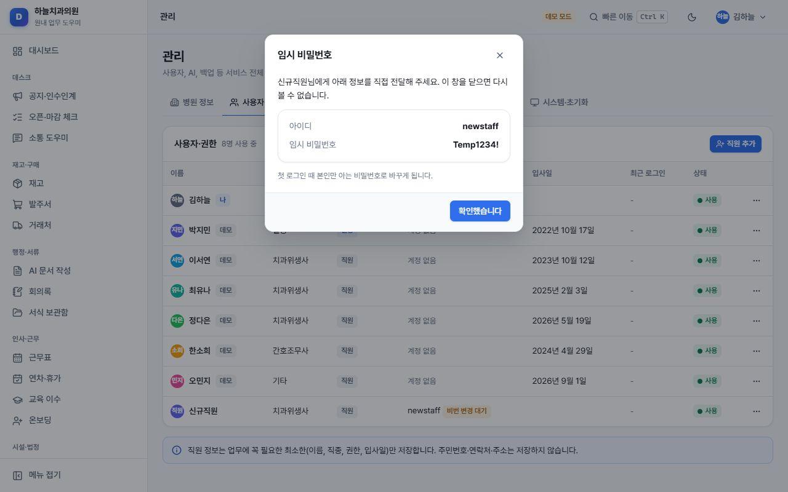

*직원 계정을 만들면 임시 비밀번호가 한 번만 표시됩니다. 직원에게 직접 전달하면, 첫 로그인 때 본인 비밀번호로 바꾸게 됩니다.*

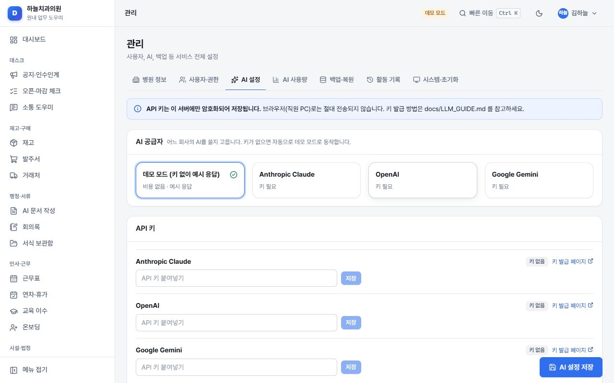

*AI 설정: 공급자 선택, API 키(서버에만 암호화 저장, 끝 4자리만 표시), 월 예산과 초과 시 차단/경고, 환율, 개인정보 필터 방식.*

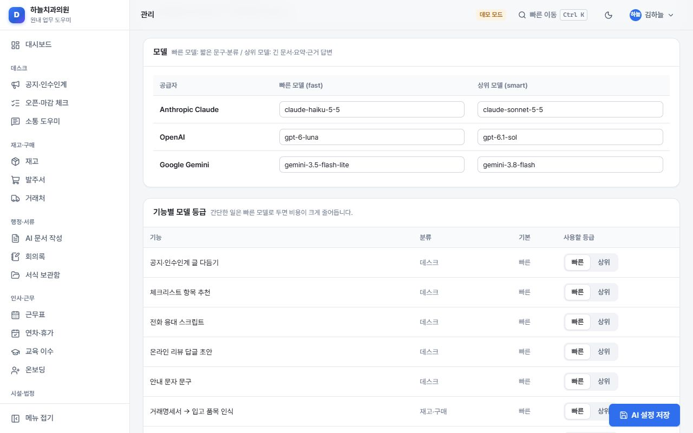

*기능별 모델 등급(간단한 일은 저렴한 "빠른 모델", 긴 문서는 "상위 모델")과 가격표. 가격은 공식 가격 기준이며 직접 고칠 수 있습니다.*

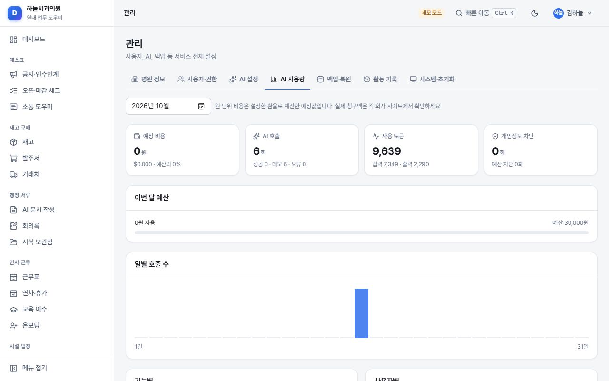

*AI 사용량·비용: 예상 비용(원), 호출 수, 토큰, 개인정보 차단 횟수, 일별 그래프, 기능별·사용자별 표, 최근 호출 기록(내용 없이 기능·토큰·비용만).*

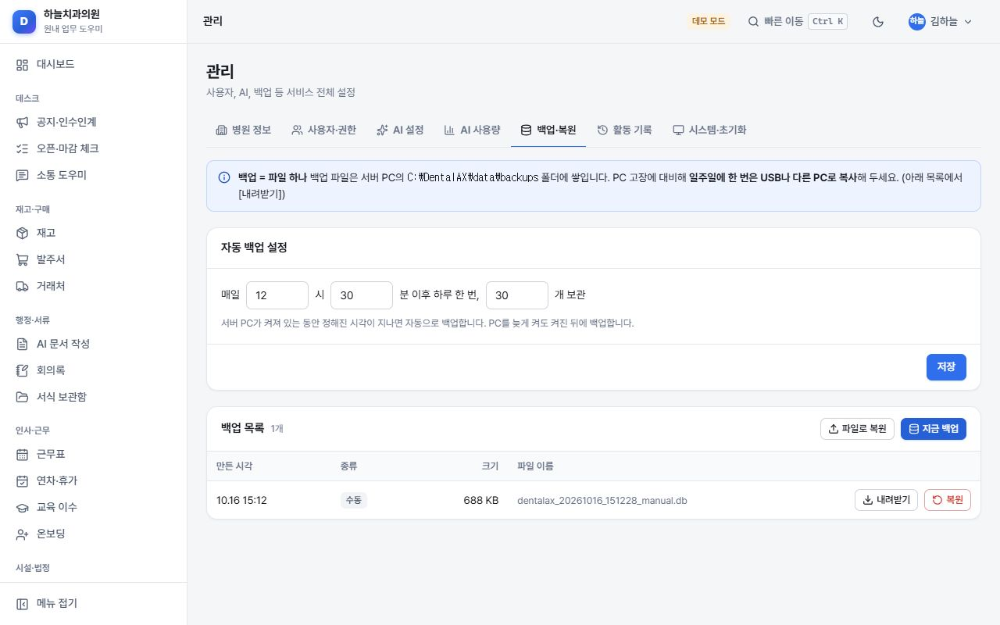

*백업·복원: 매일 자동 백업(시각·보관 개수 설정), 수동 백업, 내려받기(USB 보관), 복원(복원 전 상태 자동 백업), 다른 PC의 백업 파일로 복원.*

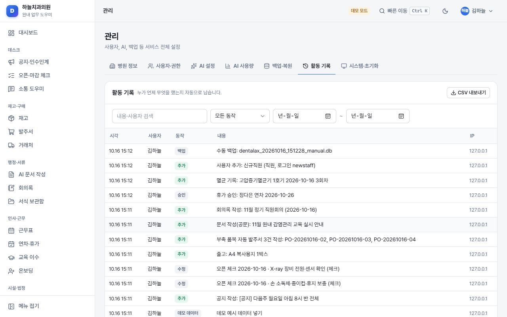

*활동 기록: 누가 언제 무엇을 했는지(로그인, 추가·수정·삭제, 백업, 설정 변경) 자동 기록, 검색·기간 필터·CSV 내보내기.*

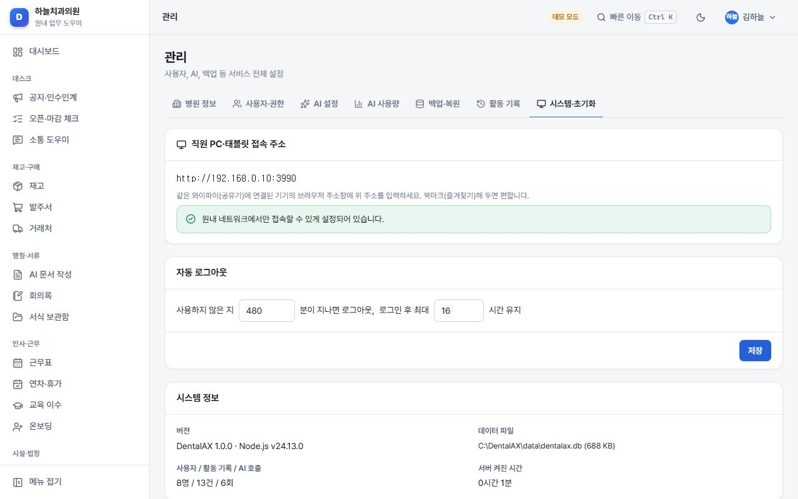

*시스템·초기화: 직원 PC·태블릿 접속 주소, 자동 로그아웃 시간, 데모 데이터 초기화("초기화" 입력 확인).*

---

## 16. 편의 기능 — 빠른 이동, 다크 모드, 태블릿·휴대폰

**Ctrl + K** 로 메뉴를 바로 찾아 이동하고, 오른쪽 위 달 버튼으로 **다크 모드**를 켭니다. 태블릿·휴대폰에서는 왼쪽 위 ☰ 버튼으로 메뉴를 엽니다.

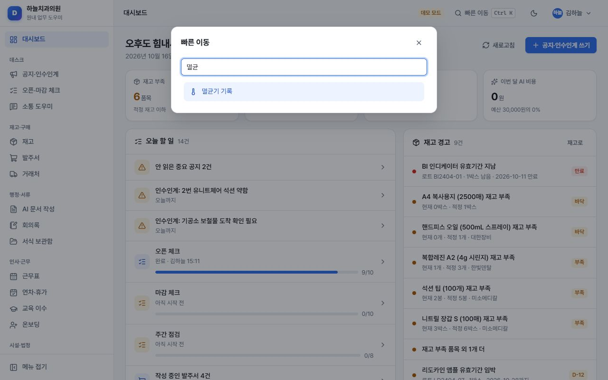

*빠른 이동(Ctrl + K): 메뉴 이름이나 관련 단어로 찾아 Enter.*

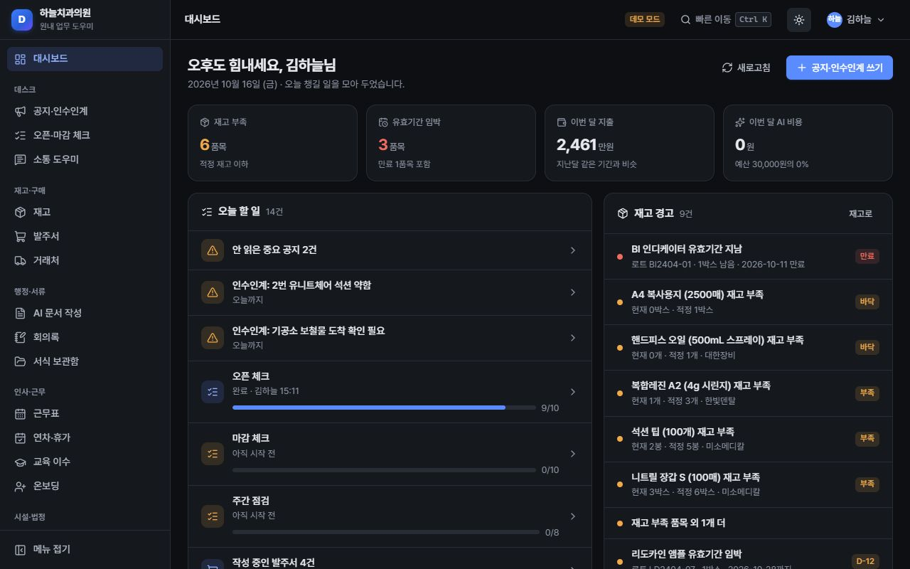

*다크 모드 대시보드.*

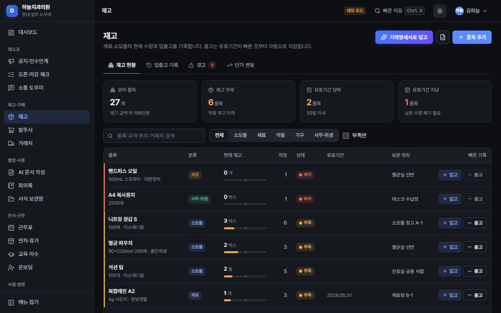

*다크 모드 재고 화면.*

*태블릿(세로) 화면: 체크리스트를 손가락으로 크게 누를 수 있습니다.*

*태블릿·휴대폰에서는 ☰ 버튼으로 메뉴를 엽니다.*

*휴대폰 화면(390px)의 대시보드.*

---

## 17. 직원 계정으로 쓰기

직원은 관리자가 준 임시 비밀번호로 처음 로그인하면 **비밀번호를 바꾸는 화면**이 먼저 나옵니다. 직원 화면에는 관리·지출·발주 메뉴가 보이지 않고, 주소를 직접 입력해도 권한 안내만 나옵니다(서버에서도 막음).

*직원 첫 로그인: 임시 비밀번호를 본인만 아는 비밀번호로 바꿔야 시작할 수 있습니다.*

*직원 화면: 왼쪽 메뉴에 관리·지출·발주서가 없습니다. 공지 읽기, 체크리스트, 입출고 기록, 연차 신청, 멸균 기록, AI 도구는 그대로 씁니다.*

---

이 안내서와 영상은 `npm run walkthrough` / `npm run walkthrough:video` 로 언제든 다시 만들 수 있습니다 (`tests/e2e/walkthrough.js`).
설치·문제 해결은 [README](../../README.md)를 보세요.
